# Operations Workspace: Pattern Analysis and Skill Design

**Date:** 2026-09-26 (rev 1) · **Revised:** 2026-10-18 (rev 2) · **Decisions recorded:** 2026-10-19 (rev 2.1, §11.2)
**Scope:** All 355 session reports across 29 report directories (2026-04 → 2026-10-18), plus READMEs, `telegram-alerts/` scripts and ledger, `docs/`, `CLAUDE.md`, and the 19 auto-memory files. Rev 2 adds the 37 sessions written since rev 1: grobiz 046–062, disk-cleanup 064–069, rekrutme 001–003, pahala 001, sijari 002–005, hoteru 019, eventopia 069 and dev 004.
**Method:** Rev 1 used eight parallel read-only passes over every session. Rev 2 used four delta passes that compared the new sessions against rev 1, plus read-only `df` and Docker checks on the Mac for the disk section. Nothing in the workspace was modified and no remote commands were run.
**Status:** Analysis only. No skills have been written yet. §0 lists what rev 2 changed, §8 is the proposed catalog, and §11 is the build plan and the decisions needed from you.

Markers: **🆕** means new in rev 2, and **✎** means rev 1 content corrected in rev 2.

---

## Contents

0. [What changed in rev 2](#0-what-changed-in-rev-2)
1. [Executive summary](#1-executive-summary)
2. [Corpus overview](#2-corpus-overview)
3. [Fleet topology and registries](#3-fleet-topology-and-registries)
4. [The general operating flow](#4-the-general-operating-flow-every-session)
5. [Workflow families (generic, cross-app)](#5-workflow-families-generic-cross-app)
6. [Context-specific flows](#6-context-specific-flows)
7. [Consolidated lessons ledger](#7-consolidated-lessons-ledger-the-guardrails)
8. [Proposed skill catalog](#8-proposed-skill-catalog)
9. [Memory → skill mapping](#9-memory--skill-mapping)
10. [Workspace hygiene issues found](#10-workspace-hygiene-issues-found)
11. [Build plan and open decisions](#11-build-plan-and-open-decisions)

---

## 0. What changed in rev 2

### 0.1 What the last three weeks showed

1. **Deploy mechanisms change faster than documentation.** Three weeks after rev 1, grobiz replaced its pull-in-place `deploy.sh` with an **app-owned release tool**: immutable releases under `~/grobiz-releases/`, a `current` symlink flip, `--plan`/`--sha`/`--rollback`, and rollback as a flip only (session 058). Every grobiz fact in the rev 1 profile is now stale. **Consequence:** app profiles need a version stamp and a "last verified" date, and `pm2-app-deploy` needs a mode that drives an app's own tool instead of re-implementing it.
2. **Two new apps reached production in five days.** rekrutme went live on 10-14 and pahala on 10-18, and the hoteru Radho tenant on a new domain followed on 10-09. They validated the rev 1 "new app to cluster" recipe and added roughly 15 steps to it (§5.12). The most important addition is a **read-only readiness session before the deploy** (rekrutme s001).
3. **The same release can now span several sessions, and sessions now start from app repos.** grobiz 050–053 is one consolidated release split into Windows 0/A/B/C. Each session stops at a context budget (~210–250K tokens) and writes a resume note. Most grobiz deploys from 054 on were **run from the grobiz repo's own Claude session**, and the Operations report is a summary of that. **Consequence:** skills that live only in this workspace would be absent from those sessions (§11.2 decision 2 changes).
4. **Secret exposure keeps recurring.** There were five more incidents in three weeks:
   - `grep '^PIN_'` printed `PIN_PEPPER` (eventopia 069);
   - generated hotel credentials were shown in the transcript (hoteru 019);
   - an echoed bcrypt hash and TOTP secret (grobiz 061);
   - a pasted token (rekrutme 002);
   - a psql quoting slip printed the prod DB URL with its password (today, memory `feedback_psql_on_app_never_echo_db_url`).

   This class is now the most frequent incident in the corpus. It argues for a **hook**, not only a skill.
5. **Disk pressure is getting worse.**
   - 10 cleanup days in 16, including five consecutive days (10-14 → 10-18).
   - Free space dropped to ≤2.3 GB three times.
   - The post-cleanup ceiling fell from 45–70 GB to about 20 GB.
   - The main cause is the Next 16 Turbopack dev cache (`.next/dev/cache/turbopack`), which grows 5–16 GB/day. A config fix landed on 10-18 and is not yet verified.

### 0.2 Section-by-section changelog

| Section | Change |
|---|---|
| §1 | Counts and summary bullets updated; skill count 16 → 19 |
| §2 | Counts updated to 355 sessions in 29 directories; October cadence added; new session types (multi-session release, read-only census, readiness assessment) |
| §3.1 ✎ | The "catch-all 444" invariant is wrong (§3.1). Added host clocks, the SSH user-to-host map, PM2 count 48 |
| §3.2 ✎🆕 | Ports 3150/3151/3160/3170, next free 3180; Redis db 11, next free db 12; Redis server 8.6.1; three new certs; CF token files are named per app, not per zone; **proxy has no certbot deploy hook**; registry now keyed per host; 🆕 expiry inventory |
| §4.1 ✎ | "Deploy only from main" → "deploy the pinned production line"; "stop after 2 SSH failures" → BatchMode + user map; four new rules |
| §5.1 🆕 | Seven new pre-flight layers |
| §5.2 ✎🆕 | App-native release-tool mode; a restart **baseline** replaces "+1 only"; hotfix-from-branch; readiness wait; known-false-alarm list updated |
| §5.3 ✎🆕 | Stage-dir swap is now canonical (instead of rsync in place); remote-repo static mode (sijari); rsync `ssh -n` and macOS `--chown` traps |
| §5.5 🆕 | Secret pipeline; verify the write; names-only `.env` reads; psql URL redaction |
| §5.7 🆕 | No-write smoke techniques, the no-state-creating-POST rule, test identity chosen per email provider, 401-once and revocation matrix, owner-owed bucket |
| §5.11 ✎ | `merge_logs` trap; observability needs an explicit owner hand-off |
| §5.12 ✎🆕 | **New-app recipe rewritten** as readiness + deploy phases |
| §5.14–5.18 🆕 | Post-deploy watch; ERPNext fleet loop; windowed release; read-only census; PWA/client-cache |
| §6.1 ✎🆕 | grobiz row rebuilt; rows added for rekrutme, pahala and Radho; sijari row updated |
| §6.2 ✎ | proxy, app, db, erp and dev rows updated |
| §6.3 ✎🆕 | Tiers renamed A/B/C; new offenders; Turbopack fix status; cadence trend; gross vs net accounting |
| §7 🆕 | Lessons L33–L52 added; L7, L14, L15 and L31 refined |
| §8 ✎🆕 | 🆕 §8.6 ecc reuse map (rev 2.1); +3 skills (`post-deploy-watch`, `erpnext-fleet-op`, `windowed-release` as a mode); 2 modules; hooks list revised; `new-app-to-cluster` gains a readiness phase |
| §9 🆕 | Six new memory files mapped; three memory files found stale |
| §10 🆕 | Hygiene items H10–H17 |
| §11 ✎ | The **skill location** recommendation changed; new decisions 8–10 |
| **rev 2.1 (10-19)** | All 10 decisions recorded (§11.2); §5.11 gains an **observability analysis** step and is promoted to Tier 2 (decision 10); codex-runtimes moved to Tier B (decision 6); hooks decided as blocking for secrets (decision 3); dev retired as a gate (decision 5); new §8.6 maps existing **ecc plugin** skills and hooks to this catalog |

---

## 1. Executive summary

- **About half the work is still shipping code to production.** Roughly 170 of 355 sessions are prod deploys. Every app uses the same skeleton: ground truth → delta analysis → approval → backup → pin SHA → pull/flip → migrate → build → restart → verify → watch → smoke → cleanup → report. Each app learned the guardrails separately, often by repeating the same incident.
- **The same incident classes recur across apps.** This is the strongest argument for skills:

  | Incident class | Where it recurred |
  |---|---|
  | **Secrets printed into transcripts or reports** | ≥17 incidents, 9 directories; 5 in the last 3 weeks (§0.1) |
  | PM2 keeps stale env after `restart <name> --update-env` | eventopia ×4, grobiz, asiaweek, ytgrab |
  | Build-time `NEXT_PUBLIC_*`/`VITE_*`/`PUBLIC_*` baked wrong | eventopia ×6, grobiz ×4 (one exposed a dev quick-login), meetgrab ×3, hoteru, ytgrab |
  | Next.js standalone missing assets, or a build killed mid-flight | hoteru, ytgrab (×2 outages), pasarbesar, eventopia |
  | drizzle-kit CLI fails silently or hangs | eventopia, grobiz (hung deploys 004–034), duitkas, miaw-route |
  | Static relay emptied a live directory | avilia 002 (~90 s 403), grobiz 058 (~10 s 403) |
  | fail2ban self-lockout from a wrong username | proxy, meetgrab, app, eventopia 031 + 069 |
  | "HTTP 200" / "exit 0" accepted as evidence while the app was broken | eventopia checkin (6 weeks), ytgrab (1.5 h), grobiz (0 of 45 sites reached with `exit=0`) |
  | Runbook or brief wrong about prod | eventopia, grobiz ×5, ytgrab ×3, hoteru ×2 |

- **The operator's rules are already written down, but they are scattered.** They live in 19 memory files, hundreds of Gotchas tables, per-app READMEs (eventopia's is 172 KB), and now also in app repos (grobiz `docs/ops/*.md`, rekrutme's rewritten runbook). Skills would bring them to the point where the work starts.
- **Recommended shape: about 19 workflow skills plus about 14 app/server profile files**, split by workflow rather than by app. App-specific facts go in versioned profile files, because grobiz showed they go stale within weeks. Four core skills cover most sessions: `ops-session`, `release-preflight`, `pm2-app-deploy` and `post-deploy-watch`.
- **Hooks matter more than in rev 1.** Secret exposure, SSH user mistakes, and relay `--delete` against an unchecked source are deterministic patterns. A hook catches them even when no skill is loaded (§8.5).
- **✎ Skill location.** Because deploys now also run from app-repo sessions, the skills should be **user-level (or a personal plugin) with the profiles kept in this workspace**, rather than project-level only (§11.2).

---

## 2. Corpus overview

### 2.1 Sessions per directory

| Directory | Sessions | Kind | Dominant session types |
|---|---|---|---|
| eventopia-app-reports | 69 | app | prod redeploy + live payment smoke (41), incident/investigation (10), config/nginx (8) |
| disk-cleanup-reports | 69 | Mac | measure → tier → approve → clean → re-measure (multi-round since S66) |
| grobiz-app-reports | 62 | app | prod deploys (~37), dev deploys (15), 🆕 read-only census/pre-flight (~8), 🆕 multi-session windowed release (050–053) |
| ytgrab-app-reports | 42 | app | release (27), monitoring (7), yt-dlp/anti-bot (9 tagged), analysis (5) |
| hoteru-app-reports | 19 | app | 3-instance redeploy (13), tenant onboarding (3, incl. Radho), initial deploy (1) |
| meetgrab-app-reports | 16 | app | surface-scoped redeploys (14), LLM/SDK changes (4 tagged) |
| monitor-sysadmin-reports | 11 | server | OpenObserve build-out, alert-noise tuning |
| miaw-route-app-reports | 8 | app | redeploys, route changes, PM2 → systemd |
| proxy-sysadmin-reports | 7 | server | audit, log shipping, alert triage, lockout, CF flap RCA |
| app / backup / seenow / sijari | 5 each | mixed | audits, backup coverage, bare-metal + cluster deploys, static launches |
| db / dev | 4 each | server | audit, log shipping, alarm triage, 🆕 OpenVPN cert renewal |
| erp / numa / duitkas / asiaweek / 🆕 rekrutme | 3 each | mixed | audits, onboarding, rename, per-client clone, observability, 🆕 readiness → deploy → origin move |
| avilia / pasarbesar | 2 each | app | initial deploy + integration; domain rotation + Next standalone standard |
| maxchat / wabacall / github / projects / 🆕 pahala | 1 each | mixed | static launch, webhook routing, Actions billing, inventory, 🆕 first prod deploy |
| **Total** | **355** | | |

### 2.2 Cadence

| Month | 04 | 05 | 06 | 07 | 08 | 09 | 10 (to the 18th) |
|---|---|---|---|---|---|---|---|
| Sessions | 8 | 36 | 84 | 88 | 61 | 47 | **31** |

There are 266 commits. October is on pace to be the busiest month. Since August most **server** sessions start from a Telegram alert, and most **app** sessions start from "deploy latest main" or a numbered hotfix.

### 2.3 How the work evolved (shared by every long series)

1. **Early phase (small, frequent deploys).** Reports are short: Context → Actions table → Verification bullets → Follow-ups.
2. **Incident phase.** Each app hits its version of the recurring incidents in §7, and a gotcha table appears.
3. **Mature phase (large catch-up releases of 100–1,275 commits).** Pre-flight becomes a layered "Layer | Needed? | Evidence" analysis. Verification becomes a matrix. Smoke tests include exact-ID cleanup. Reports reach about 20 KB.
4. **🆕 Tooling phase (grobiz since 050, rekrutme from day one).** The app repo owns the runbook and the deploy tool. Releases run in timed windows with owner-decision lists and one-way-door registers. Post-deploy watches run at +30 and +60 min. The Operations report becomes the summary, and the repo doc holds the full record.

The skills should encode phases 3 and 4, so that a new app starts there instead of relearning them.

---

## 3. Fleet topology and registries

### 3.1 Request, data and alert flow

```
Internet ─► Cloudflare (orange, Full-strict; eventopia.my = Full for custom domains)
             └─► proxy 46.250.234.153 / 10.0.0.2  (nginx 1.24, TLS/certbot, fail2ban)
                  ├─► app      10.0.0.5  48 PM2 procs under devops, bound to 10.0.0.5  (+ miaw-route systemd :9001)
                  ├─► erp      https://10.0.0.6  (ERPNext v16 bench, 49 site DBs, *.erp.gro.biz.id) ─► db MariaDB
                  ├─► monitor  10.0.0.3  (errors./analytics./status./vault./observe.)
                  ├─► numa 10.0.0.7 + db 10.0.0.1 :7009   (ytgrab-api, nginx least_conn w=2/w=1)
                  └─► static /var/www/*  on proxy  (SPAs, PWAs, marketing, holding pages)
app ─► db 10.0.0.1  (PG16.9 :5432, Redis 8.6.1 :6379, Mongo, ClickHouse, MariaDB)
backup 10.0.0.4 ─pull─► db (pg_dump as backup_reader, tier-2 auto-discovery) + erp (bench backup) + app (forced-command cat .env)
dev 154.26.130.96  standalone: PM2 under deploy, local PG14/Redis, system nginx, cloudflared, OpenVPN, UFW off (by decision)

Alerts ─► single Telegram chat:
   Netdata (5 hosts) · Uptime Kuma (~50 monitors, push canaries) · backup notify.sh · OpenObserve (4 rules)
   └─ telegram-alerts: /opt/telegram-alerts on monitor (hourly pull, 08:00 WIB digest); Mac uses ./sync.sh
Logs ─► Fluent Bit on every host ─► OpenObserve streams (nginx, app, db, erp, monitor, backup, dev, numa, syslog)
```

**Invariants the skills must know:**
- `app` cannot SSH to `proxy`. Every static deploy relays **app → Mac → proxy**, or comes from a fresh clone on the Mac.
- **✎ SSH user-to-host map:** `proxy`, `db`, `erp`, `monitor`, `backup` and `numa` use `root`; `app` uses `devops`; `dev` uses `deploy`. Use `-o BatchMode=yes`. Proxy's sshd jail is `maxretry 3`, `findtime 600`, `bantime 86400` and counts auth **events**, so one interactive invocation with a wrong user can ban for 24 h (eventopia 069). To recover, go `root@app` → `10.0.0.2` (whitelisted) → `fail2ban-client set sshd unbanip <ip>`.
- Anything on `app` binds to `10.0.0.5`, never `127.0.0.1` (which gives 502s) or `0.0.0.0` (which exposes it). ytgrab-api binds `10.0.0.7`/`10.0.0.1`. Rollback scripts and health checks must use the bound address too (grobiz 058).
- **🆕 Host clocks differ:**

  | Host(s) | Clock |
  |---|---|
  | `app`, `erp` | Europe/Berlin (CEST, WIB − 5 h) |
  | `db`, `proxy` | WIB |
  | Playwright | UTC |

  Apps set `TZ=Asia/Jakarta` themselves. Normalise every time in a report, and convert scheduled-job times (§5.1).
- **✎ There is no working catch-all on proxy.** Unknown names on 443 match `eventopia-custom-domains.conf` (`server_name ~^.+$`), which gives the Eventopia 404 or a CF 526. Port 80 hits `sites-enabled/default`, which serves the Apache default page with 200 (rekrutme s002).
- Before trusting any runbook in an app repo, check the live nginx upstreams and PM2. **🆕 For a new app**, fix the repo runbook for this cluster first rather than ignoring it (rekrutme). For a mature app, re-read every runbook fact live with line references (grobiz 050).

### 3.2 Registries

The skills will need these registries as one reference file, keyed **per host** (🆕: dev `:7007` is rekrutme while `app :7007` is miaw-api-baznas). `projects-reports/session-001` (2026-05-12) is stale, so every entry needs a **verify-live command**: `ss -tlnp`, `redis-cli INFO keyspace`, `pm2 jlist`, `certbot certificates`.

**Ports on `app` (10.0.0.5, PM2 user `devops`, 48 processes):**

| Port(s) | Process | Source |
|---|---|---|
| 3001–3007, 7001, 7004–7006, 8001–8003 | teamy / wagrab / washop / feyfa / quranchat / qute (legacy inventory) | projects s001, **stale** |
| 3009 | ytgrab-web | ytgrab |
| 3110 / 3111 / 3112 | hoteru-api / -public / -marketing (central) | hoteru |
| 3120 / 3121 | hoteru-tpm-api / -web (Technopark) | hoteru s002 |
| 3130 / 3131 | hoteru-bwalk-api / -web | hoteru s008 |
| 🆕 3150 / 3151 | hoteru-radho-api / -web (`~/hoteru-radho`) | hoteru s019 |
| 3140 | avilia-api | avilia |
| 🆕 3160 | rekrutme (fork ×1, Next standalone, nvm Node 22) | rekrutme s002 |
| 🆕 3170 | pahala (fork ×1, `next start`, nvm Node 22) | pahala s001 |
| **🆕 next free** | **3180** (31x0 band, step 10; verify with `ss -tlnp`) | derived |
| 4000 | grobiz-api (+ 7016 admin, 7017 landing, 127.0.0.1:4720 wa-gateway) | grobiz |
| 4900 / 4901 | seenow-api / seenow-web-public | seenow s003 |
| 7002 / 7003 | pasarbesar / pasarbesar-lpekinhub | pasarbesar s002 |
| 7007 / 7008 | miaw-api-baznas / miaw-web-baznas | duitkas s001 |
| 7013–7015 | asiaweek-web / -app / -api | asiaweek s002 |
| 7018 / 7019 | miaw-api-lpekin / miaw-web-lpekin | duitkas s002 |
| 8930 (+ 8931 uploads nginx) | meetgrab-api (+ hoteru uploads) | meetgrab, hoteru s007 |
| 9001 | miaw-route (**systemd**, Bun) | miaw-route s008 |
| 38001 / 38100 / 38200 / 38400 | eventopia-api / -web-public / -console / -operator | eventopia |

**Ports on `dev` (154.26.130.96, PM2 user `deploy`):**
- 4030 avilia staging
- 4900/4901 seenow
- 6001–6003 asiaweek
- 🆕 7005 `dev.pahala.co`
- 🆕 7007 `dev.rkrt.me` (old code)
- 7006 grobiz
- 19000 wabacall
- 🆕 OpenVPN UDP 1194

**Redis logical dbs** (🆕 server 8.6.1 on `db`; the `app` client is 7.0.15, so always measure at the server):

| Host | db | Owner |
|---|---|---|
| db | 0 | duitkas baznas (`baznas:` prefix) |
| db | 1 | miaw-route |
| db | 2, 3 | in use, unlabelled: **verify** (runbooks that say "db 3" for grobiz are quoting the dev convention; prod grobiz is db 4) |
| db | 4 | grobiz (`tenant:<id>:config\|:account\|:config:fill`) |
| db | 5 | duitkas lpekin (`lpekin:` prefix) |
| db | 6 | eventopia prod |
| db | 7 | seenow prod |
| db | 8 / 9 / 10 / 🆕 11 | hoteru central / technopark / bwalk / radho |
| db | **🆕 12** | **next free** (rekrutme and pahala use no Redis; verify) |
| db | ? | ytgrab (shared instance, 30k+ keys): **never FLUSHDB** |
| dev | 0 (shared, ~30k keys), 2 (eventopia), 3 (seenow) | — |

**Postgres** (db PG 16.9; dev PG14):
- One role and one database per app. 🆕 New DBs: `hoteru_radho`, `rekrutme`, `pahala`.
- RLS apps use an owner role with `BYPASSRLS` (not superuser) plus a non-superuser runtime role.
- 🆕 Owners need `CREATE` on their DB when the app creates schemas at runtime (rekrutme: drizzle `drizzle` + pg-boss `pgboss`).
- Untrusted extensions are created as `postgres`.
- `pg_hba` allows `10.0.0.0/22` md5 (SCRAM is accepted); `listen_addresses = localhost,10.0.0.1`.
- db session TZ is Asia/Singapore, which matters for timestamp migrations.

**TLS / Cloudflare tokens on proxy:**

| Method | Certs | Credential |
|---|---|---|
| DNS-01 (wildcards OK) | eventopia (.my + .co.id), seenow.ac, meetgrab.us, hoteru.uk / .co.id / 🆕 roomrate.co, gro.biz.id | ✎ files are named **per app, not per zone**: `cloudflare-eventopia.ini`, `cloudflare-seenow.ini`, `cloudflare-meetgrab.ini`, `cloudflare-gro.ini`, `cloudflare/hoteru.ini` (covers 3 zones, re-scoped in s019). Check the token's zone scope, not its filename |
| HTTP-01 webroot `/var/www/certbot` | sijari.uk, avilia.id, v4.maxchat.id, 🆕 rkrt.me, 🆕 pahala.co | none. A new subdomain means a re-issue. CF "Always Use HTTPS" breaks renewal |
| `certbot --nginx` | routes.biji.uk, duitkas, asiaweek, pasarbesar | none |

Cloudflare rules:
- Two-level subdomains must be **grey-cloud** (Universal SSL covers one level).
- Expect 526 until the origin cert exists.
- Use `--dns-cloudflare-propagation-seconds 45`.
- 🆕 Bot Fight Mode must not block webhooks: a datacenter-IP POST should get the app's 401 with no `cf-mitigated` header.

**🆕 Expiry inventory.** Nothing tracks these today:

| Item | Expires | Note |
|---|---|---|
| sijari.uk | 2026-12-25 | soonest |
| hoteru Radho | 2027-01-06 | |
| rkrt.me | 2027-01-11 | |
| pahala.co | 2027-01-16 | |
| rkrt.me domain | 2027-02-23 | auto-renew is an owner item |
| dev OpenVPN CA | 2034-06-21 | |
| OpenVPN CRL | — | Easy-RSA's default lifetime is 180 days; when it lapsed, it rejected every client |

**Risk: proxy has no certbot deploy hook** (`renewal-hooks/deploy/` is empty), so renewed certs are only served after some later nginx reload. No session has filed this yet.

---

## 4. The general operating flow (every session)

```mermaid
flowchart TD
  T[Trigger: user ask / Telegram alert / 'deploy latest main' / numbered hotfix / 'disk full'] --> C[Load context:<br/>README current-state + open follow-ups,<br/>last 1-2 sessions, relevant memory,<br/>repo runbook/state docs if the app owns them]
  C --> G[Ground truth from the live system<br/>read-only, no approval needed<br/>detect unrecorded deploys]
  G --> A[Analyse: delta / root cause / census / readiness<br/>fan out subagents for big ranges]
  A --> P[Plan: steps + exact commands + risks + rollback<br/>owner decisions as Evidence / Options / Recommend]
  P --> AP{User approval<br/>per write step, per tier,<br/>or 'all approved, stop on unresolved'}
  AP -- declined/changed --> P
  AP -- approved --> GT[Go-time gate:<br/>re-check SHA / traffic / scheduled jobs / money state / headroom]
  GT --> B[Backup: pg_dump + restore-list, .env.bak, dist/config copies,<br/>Redis-only state export, rollback SHA or release id]
  B --> X[Execute, one unit at a time<br/>long jobs detached + PID/log asserted]
  X --> V[Verify against the authoritative source<br/>not exit codes / not HTTP 200]
  V -- failed gate --> STOP[Stop, report, ask]
  V --> W[Post-deploy watch: L1 / +30 / +60 min log scans]
  W --> S[Smoke test, no-write where possible,<br/>captured IDs where not]
  S --> CL[Cleanup by exact ID + residue/baseline check<br/>owner-owed items listed]
  CL --> R[Report: session-NNN file + README row/state/follow-ups<br/>or resume note if the release continues]
  R --> CM{User says commit?}
  CM -- yes --> CO["docs(slug): session-NNN — topic (date)"]
```



### 4.1 Cross-cutting rules (apply to every skill)

| Rule | Origin |
|---|---|
| Read-only SSH is free. Every write step is described with its exact commands, then waits for explicit approval, per logical step. A gate STOP is never bypassed silently: the owner rules on it and the report records the ruling | CLAUDE.md; grobiz 058 |
| **Ground truth is the host, not the README or the brief.** Check live SHA/release, migration count and PM2 state first. READMEs were wrong because of unfiled deploys in grobiz 033/038/041/057, eventopia 022 and meetgrab 002 | grobiz, eventopia |
| ✎ **Deploy the pinned, reviewed production line.** That is normally `origin/main`, re-checked against the analysed SHA right before anything pulls. Sanctioned exceptions (hotfix or deploy branch, ancestor-SHA push) need the owner's OK, and `origin/main` must equal the pin whenever a script pulls. Push only `git push origin <pin>:main`, never a local main that is ahead | memory; grobiz 041/044/049/054–057 |
| Verify with the **authoritative source**: `/proc/<pid>/environ` not `pm2 env`; `information_schema` not the migrator log; served bytes over HTTPS not the build dir; real browser render not `curl 200`; data rows not status codes; 🆕 dependency version at the server endpoint, not the local client | eventopia, grobiz, ytgrab, hoteru |
| A grep is a hypothesis and a `--dry-run` is the evidence. 🆕 A dry-run cannot see collisions within its own batch | memory; grobiz 027; eventopia 069 |
| 🆕 **Success means `reached == expected`, not exit 0.** Verify every write happened: key counts, a diff against the backup, PID and log present after `nohup` | grobiz 052 (0 sites with exit 0; empty `.env` append; a `nohup` that never started) |
| Never delete real data: exact captured IDs, baseline counts, residue check, explicit `COMMIT;`. 🆕 Never send a state-creating request on the assumption it will be refused | memory; hoteru 019 |
| Never delete before verifying the replacement: stage, validate, swap, keep a `.prev` or backup | memory; avilia 002; grobiz 058 |
| ✎ **Never print secrets.** List `.env` names only (`cut -d= -f1`); always double-quote DB URLs and pipe output through a redaction `sed`; generate secrets on the host; compare by hash or length; an echoed credential is burned and must be regenerated | 17+ incidents (§1) |
| Respect earlier sessions' recorded decisions | eventopia 014 |
| ✎ SSH: use the user-to-host map and `-o BatchMode=yes`; never guess credentials. `Permission denied` means the wrong user, not a ban | proxy s4, eventopia 069 |
| 🆕 Normalise host time zones in reports; convert scheduled-job times per host | grobiz 049–061 |
| `ls` the report dir right before choosing a session number | eventopia 051 |
| Watch for concurrent agents. 🆕 Isolate the browser (a shared Playwright profile can be locked by another session) | eventopia 008/013/032; grobiz 061 |
| State what was **not** tested, and why. 🆕 List owner-owed items separately | grobiz 035+, 052 |
| 🆕 The permission system is the authority. If auto-mode blocks a push or delete, ask the user (they can run `! <cmd>`); don't work around it | grobiz 054, sijari 005, disk S66 |

---

## 5. Workflow families (generic, cross-app)

### 5.1 Release pre-flight: delta analysis (every prod redeploy)

**Output:** a `Layer | Needed? | Evidence` table plus a plan with approval points.

| Layer | What to check | Lesson it encodes |
|---|---|---|
| Live state | SHA or release on host, reflog, deploy logs, migration count, PM2 procs + restart baseline. 🆕 Detect a host SHA with no report (unrecorded deploy) | README drift (grobiz ×4, eventopia 022) |
| 🆕 Brief/runbook vs prod | Was the brief or runbook written against an older prod? Re-read every runbook "§0 fact" live, with line references | grobiz 050, 057 |
| Range | `git log <live>..<pin>`, the **full** range | eventopia 038 |
| Repo deploy notes | `docs/launch/*.md`, `docs/runbooks/*.md`, `docs/ops/*.md`, `docs/DEPLOY_*.md`. Ground-truth each claim. 🆕 When the app's tool has a `--plan`, its output is the blast-radius evidence, not the runbook | grobiz 038/044/059, eventopia 052 |
| Migrations | Read every SQL file; DDL-only vs data-carrying; pre-run collision predicates read-only against prod; table sizes; drizzle cursor safety (§5.6). 🆕 Classify **one-way doors** and the **rollback hazard** of each | grobiz 027/060/061 |
| Backfills | List them; `--dry-run` first; 🆕 plan a second pass expecting `Changed: 0` | grobiz 027, 046, 052 |
| Env | Diff `.env.example` + grep `process.env` / `import.meta.env` / `NEXT_PUBLIC_*` / `VITE_*` across the range | eventopia 029 |
| **Boot guards** | Grep the whole boot path for prod-only throws, `process.exit`, `Refusing to start` (🆕 grobiz also refuses on `GROBIZ_WORKTREE_SLOT` / `BACKGROUND_JOBS=off`) | grobiz 027/039, eventopia 006/046 |
| 🆕 State outside Postgres | Redis-only identity or state: export the keys before deploying; note RDB vs AOF | eventopia 069 |
| 🆕 Scheduled jobs | The app's in-process cron table, converted to host TZ. Don't let a restart cross a job (grobiz retention 12:00 WIB, billing 09:00 WIB) | grobiz 055/060/061 |
| 🆕 Money/state census | Read-only predicates (unpaid invoices, recent webhooks, awaiting states) under `default_transaction_read_only`, **re-run at go-time** | grobiz 058 (2 invoices minted after the census) |
| 🆕 Multi-tenant identity drift | Tenant key vs ERPNext Company key; leading/trailing whitespace (MariaDB PAD SPACE ≠ JS `===`) | grobiz 046/052 |
| 🆕 Client artifacts | Release holds, store-version floors, extension manifest vs package version, baked URLs (OWNER items, since they're not visible from the server) | grobiz 053 |
| 🆕 Review coverage | Was the planned code review done (Codex/Opus), or is coverage degraded? | grobiz 047/050 |
| Deps | Lockfile diff, native modules, `file:` tarballs; 🆕 dependency versions measured at the server | app s5, grobiz 060 |
| Blast radius | Per-app diff → which procs rebuild/restart (or the tool's `--plan`) | all |
| Ordering | Restart order from launch notes (api + workers together for delivery) | eventopia 066 |
| Edge prerequisites | nginx carve-outs needed before app code ships | eventopia 051 |
| Headroom | Disk, RAM, swap; build memory; 🆕 old releases piling up | eventopia 067, grobiz 059–061 |

**Go-time gate** (immediately before executing):
- Re-fetch the pin on the Mac and the host.
- No payments or scans in the last N minutes.
- 🆕 Re-run the money predicates.
- 🆕 No scheduled job inside the window.
- PM2 online.
- 🆕 Re-run the gate after any pause (grobiz 046 paused for 11 h).

### 5.2 Pull-based PM2 app deploy (execute + verify)

**Mode A: generic (apps without their own tool).**
```
backup:   pg_dump -Fc → pg_restore --list (record TOC count) · .env.bak-<tag>-<ts> · rollback SHA
          (+ dist/ copy, ecosystem copy, bench backup, Redis-only key export where relevant)
pin:      git fetch && git merge --ff-only <analysed-sha>
install:  pnpm install --frozen-lockfile
migrate:  the app's SAFE migrator → verify DDL independently   (migrate BEFORE build: prerenders may query the DB)
backfill: --dry-run → apply → second pass expects unchanged → re-query independently
build:    only changed apps, sequential, heap cap, `nohup … < /dev/null` with exit marker; clean .next when build env changed
restart:  via ecosystem file (`pm2 startOrRestart ecosystem.config.cjs --only a,b --update-env`), in mandated order; `pm2 save`
          readiness-wait on /health before running checks (Bun ~10 s, Next ~5 s, grobiz dev ~50 s)
verify:   restart counts vs recorded BASELINE · /proc/<pid>/environ · private + public health + SHA · 401-not-404 with a 404
          control · bundle grep (expected/forbidden values, dev controls absent) · browser 0 console errors · known-noise diff
rollback: documented in every report
```

**🆕 Mode B: app-native release tool** (grobiz since 058; likely to spread to other apps). The skill **drives** the tool and does not re-implement it:
1. Pre-read: `readlink current`, restart counts, `/health`, disk.
2. `deploy.sh --plan`, used as the evidence.
3. Owner approval.
4. `pg_dump` + TOC count.
5. `deploy.sh --sha <pin> [--with-…] | tee logs/deployN-<ts>.log` inside **tmux**.
6. Parse `RESULT:` / `EXIT=` and classify every warning against the profile's known-warning list.
7. Record the new restart baseline, the release id, and the **rollback hazard**. Examples: "never roll the API back past this deploy except to stop an outage"; "after a rollback past 0086, bump `token_version`".
8. Rollback is the tool's `--rollback [--to <id>]`.

**🆕 Hotfix-from-branch module** (grobiz 049/057):
1. Push the hotfix or deploy branch.
2. Host guard: HEAD = prod SHA, no tracked changes.
3. `fetch` + `checkout --detach <sha>` or `merge --ff-only`.
4. **Diff guard**: `git diff --name-only <prod> HEAD` equals the expected file list.
5. Build with inline env, then grep the bundle and check in a browser.
6. Record the obligations it creates (re-pin, merge-back, reset to main before the next deploy).

**Known false alarms** (per app, in profiles): ✎ grobiz `health-check.sh` PG/Redis FAIL **with the legacy script only**; grobiz `deploy.sh sleep 3` false "HEALTH CHECK FAILED"; eventopia OTel duplicate-registration and the audit chain break at seq 56; 🆕 eventopia Bun API 502 for ~10 s (wait ≥20 s); a 5 s 502 after restart (meetgrab, hoteru, miaw-route); dev grobiz API ~50 s boot; 🆕 grobiz `curl` to SPA routes → JSON 404 without `Accept: text/html`.

### 5.3 Static site / SPA / PWA to proxy

**✎ Canonical install step: stage-dir swap**, not rsync in place. sijari and hoteru already use it, and grobiz's relay emptied a live directory using rsync in place.

**Mode A: app-built relay** (grobiz order/partner, eventopia checkin, hoteru mgmt, meetgrab, avilia, seenow):
1. Build on `app` with build-time env exported inline.
2. **Artifact gate:** grep the dist for expected and forbidden values (`localhost:`, dev host, wrong key format, 🆕 dev controls such as a quick-login).
3. Pull the dist to the Mac in its **own** SSH call. Never mix a binary stream with other output. **🆕 Never use `ssh -n` as rsync's transport (`-e 'ssh -n'`)**: it breaks rsync's protocol (code 12) and leaves an empty copy, which `--delete` then propagates to live (grobiz 058).
4. Validate: tree md5/sha256 on host = Mac. Use `md5 -r` on the Mac and `md5sum` on Linux with `LC_ALL=C`, and check the pipelines agree first (grobiz 061).
5. Upload to a stage dir on proxy. **Refuse unless the stage is non-empty, holds `index.html`, and its hash matches.** Run under `set -euo pipefail`.
6. Back up live (`cp -a` + `diff -r`), then swap (`mv live .prev; mv .new live`) or `rsync -rlt --delete` from the verified stage. **🆕 macOS rsync has no `--chown`**: set ownership remotely (`chown -R www-data:www-data`, then dirs/files mode).
7. Verify the **served bytes over HTTPS**: root, a hashed asset, a deep route, content types. Account for the CF cache (cache-buster or owner purge) and the PWA precache (§5.18).
8. 🆕 Prefer the repo's own relay script when one exists (grobiz `relay-partner.sh` → `relay-static.sh --proxy-host root@proxy`).

**🆕 Mode B: remote-repo static site** (sijari since s002, repo `biji-ext/sijari-web`, which is outside the `biji-dev` org):
1. Pre-check: local HEAD == `git ls-remote origin main`, since unpushed commits are invisible. Hash the live tree against the target commit, and the live vhost against the repo's `deploy/*.conf`.
2. **Fresh clone** into the scratchpad, then re-confirm HEAD == `ls-remote`.
3. rsync into `/var/www/<site>.new` with an explicit exclude list (`.git .remember .playwright-mcp tools deploy .DS_Store README CLAUDE .gitignore` + unreferenced media). **The expected file count is the assertion** (24 for sijari).
4. `chown www-data`, assert 0 dotfiles, sha256 compare.
5. Swap with `.prev` kept as the one-step rollback.
6. nginx only if `deploy/` changed.
7. Origin + edge verification; forbidden paths 404; CF purge if an un-fingerprinted asset changed (dashboard, owner).
8. **Fresh browser context** at 1366 + 390; pass the **age gate**; scroll lazy images.

### 5.4 Proxy edge change (nginx vhost / cert / DNS)

1. `ls -la sites-enabled/`. Some files are real files, not symlinks, and have drifted. Confirm what is actually loaded with `nginx -T`.
2. Back up **outside** `sites-enabled/` (to `/root/nginx-backups/`).
3. Edit in house style:
   - for Next standalone at the apex, no `X-Forwarded-Proto`;
   - headers at server level only;
   - a bare `return` in `server{}` beats every `location`;
   - long timeouts go in the **443** server;
   - 🆕 HSTS `includeSubDomains` at the apex commits **every** subdomain to HTTPS, so check existing subdomains and never preload-submit without the owner (rekrutme s003).
4. 🆕 **Two-stage vhost for new names**: port-80 ACME → cert → full vhost, auto-reverting if `nginx -t` fails. This is now the standard for sijari, rekrutme and pahala.
5. 🆕 **CF real-IP restore, scoped to the vhost**:
   - `set_real_ip_from` the CF ranges (diff them against `cloudflare.com/ips-v4|v6`) + `real_ip_header CF-Connecting-IP`, and the app trusts `x-real-ip`;
   - without it, every per-IP limiter keys on CF edges;
   - prove it by tripping the limiter from one network while another still passes (rekrutme, pahala).
6. `nginx -t && systemctl reload nginx`. Re-read after any `sed`.
7. Cert: follow the decision tree (§3.2); then `certbot renew --dry-run --cert-name X`; 🆕 reload nginx after renewals until a deploy hook exists.
8. Verify the origin first (`curl --resolve host:443:46.250.234.153`), then through CF.
9. App-side follow-through: `CORS_ORIGINS`, Better Auth `trustedOrigins`, OpenPanel CORS, 🆕 `TRUSTED_IP_HEADER`.

### 5.5 Env / secret change

- **Classify first.** Build-time vars mean a clean rebuild plus a bundle grep. Runtime vars mean a restart via the ecosystem file plus `/proc/<pid>/environ`.
- **Boot-guard env:** validate on a throwaway process on a spare port first (grobiz 039).
- **🆕 Read safely:**
  - names only (`cut -d= -f1`) or lengths;
  - load `DATABASE_URL` with `U=$(grep -E '^DATABASE_URL=' .env | cut -d= -f2-)` and call it through a function that always double-quotes it: `p() { psql -X -A -t -F '|' -v ON_ERROR_STOP=1 "$U" "$@" 2>&1; }`;
  - pipe the whole SSH output through `sed -E 's#postgres(ql)?://[^ "]+#<db-url-redacted>#g'`.
- **🆕 Secret pipeline** (grobiz 051/052):
  1. `openssl rand -hex 32` into a 0600 file, never printed.
  2. sha256-compare against sibling secrets to prove it is distinct.
  3. Owner stores it in the password manager.
  4. Append over stdin.
  5. Verify key count, length and sha256 prefix on both ends.
  6. Delete the local plaintext.
- **Edit** with an exact-key `sed` anchored on the real assignment. 🆕 **Verify the write happened** (diff against the backup): a `read` on a file without a trailing newline once wrote nothing (grobiz 052).
- **Rotation:** inventory every file holding the key; hash-compare; swap; restart each; verify functionally.
- **🆕 Third-party credentials:** prove each one with a harmless authenticated call (Spaces HeadBucket, Anthropic check, Resend check, Midtrans status lookup of a missing order: 404 means authenticated, 401 means a bad key). Keys copied between environments must be validated in production form; pahala's dev Midtrans key was stored base64-wrapped.
- **Fossil env:** periodically diff `.env` against the running env. Semantic ordering of flips matters.

### 5.6 Database migration safety

| ORM / mechanism | Rule |
|---|---|
| **drizzle-kit CLI** | Never on prod (fails silently, falls back to localhost, `push` hangs and does naive ALTERs) |
| **drizzle-orm migrator** (eventopia `run-migrate.mjs`) | From `packages/db` with `--env-file=../../.env`. Before running: journal monotonic, and every pending `when` > `MAX(created_at)`. Manual repair inserts the migration's **own** `when` |
| **Numbered SQL** (grobiz `db:apply-sql`) | Idempotent re-apply, gated by drift checks before and after. 🆕 Under the release tool, migrations run **before** the flip and must stay additive so that rollback is a flip only |
| **Prisma** (hoteru, avilia, pahala) | Check `_prisma_migrations`; preview with `migrate diff --script`; scratch-DB dry-run for conflicts; baseline with `resolve --applied`; never `db push` on ledger-managed DBs |
| **Any ORM** | Verify DDL via `information_schema` / `pg_indexes` / RLS flags / `indisvalid`; TZ-safe ALTERs; lock timeouts; pull before migrate; 🆕 migrate before build when a prerender queries the DB |
| **Guarded data fix** | Dry-run count → range-guarded transaction → backup table → UPDATE + assert → rollback SQL → drop the backup only on request. 🆕 Re-take counts immediately before the UPDATE |
| **🆕 Rehearsal on prod copies** (grobiz 051) | Operator backups → local container stack at prod versions → dry run → real run → re-run → snapshot diffs → teardown and delete the dumps |
| **Redis** | Scoped `--scan --pattern` delete only. Never `FLUSHDB` |

### 5.7 Live production smoke test and cleanup

1. **Identity.**
   - A disposable identity (never Gmail).
   - 🆕 Choose the address per email provider: use `delivered+<tag>@resend.dev` when Resend delivery is under test, because Resend rejects `example.com`.
   - A team test tenant (grobiz `59aba5d4`, `2caaaf0a`; 🆕 these replaced the PIN canaries).
   - Or 🆕 an **unreachable phone number** that can't be a real line (`62000004601`).
2. **🆕 Prefer no-write techniques:**
   - **Host-signed short-lived tokens:** minted on `app` with the API's own secret, 10–25 min, shredded afterwards.
   - **No-write browser guard:** Playwright aborts every non-GET `/api/` call, proven with a probe `POST` → `ERR_BLOCKED_BY_CLIENT`. This allows UI smoke on real tenants.
   - **Revocation matrix:** token version +1 → `SESSION_REVOKED`; deleted user → `ACCOUNT_INACTIVE`; bad signature → 401; logout + replay → 401. Rule out token expiry as the explanation (pre-switch token pairs).
   - **401-once check:** one refresh, one retry, then stop, with no loop and no 429.
   - **Fixture pre-read:** confirm the test tenant's state actually suits the case.
3. **Where writes are needed:**
   - Capture every ID and take baseline counts **before** any write.
   - **🆕 Never send a state-creating request expecting it to be refused.** The hoteru API accepted a booking on a 0-room tenant. Assert the UI or availability gate instead.
   - **Throwaway privileged accounts:** INSERT with their own bcrypt + TOTP, drive the real login, then DELETE by exact id with `raise exception unless` the count matches.
   - **🆕 Byte-for-byte restore** of toggled rows (save to a 0600 TSV, restore, assert `identical = t`, bump `token_version`, delete the exact Redis keys).
4. **Payments:** minting is not settling. Close the loop and run the fail-closed probes.
5. **Cleanup:**
   - Scan every tenant-keyed table.
   - FK order, with an explicit `COMMIT;`.
   - Real PK forms.
   - Redis keys, incl. the `membership:` home keys.
   - Keep the audit tables.
   - 🆕 Record residue that can't be removed (a moved `last_login_at`, an unrevokable owner JWT, the absence of an admin audit row).
   - 🆕 Clear the in-memory limiters with a `pm2 restart` as a **planned** write step (rekrutme).
6. **Verify:** zero residue plus a total-row-count delta.
7. **Report:** 🆕 an **owner-owed** list (2FA UI walks, per-till reloads, store uploads, CF purges) and a "not done on purpose" list.

### 5.8 Read-only incident / support diagnosis

1. State the user's hypothesis and test it explicitly.
2. Logs, then DB, then source at file:line, then a live reproduction.
3. Separate variables; use control sets; trust the aggregate over a single canary.
4. Check external sources of truth (Xendit, Resend `GET /emails`, Meta codes, GA Realtime).
5. Measure the blast radius exhaustively.
6. Prove the fix without server writes where possible.
7. Write a verdict, a "why nobody caught it" section and a fix spec; file a `known-issues.md` entry. **No fix unless asked.**

### 5.9 Alert triage (infra, Telegram-driven)

1. `telegram-alerts/sync.sh`, then a `jq` aggregate of the ledger. Caveats: rows labelled CRITICAL before 2026-09-20 were really WARNINGs, and the ledger includes silent alarms.
2. Live state: Netdata API, Kuma, `backup.log`, OpenObserve.
3. Layered correlation: CF codes → proxy logs bucketed by minute → app (`ss -tlnp`; "online" ≠ listening) → host PSI/swap → db.
4. Decide: real fault, threshold inside baseline, duplicate parent evaluation, or benign gauge.
5. Netdata override: full template copy in `health.d`, `reload-health`, verify via the API, sync `digest.py`, recheck the ledger in 1–2 days.

### 5.10 Server audit and hardening

1. Read-only recon: `sshd -T` incl. cloud-init drop-ins, keys, `ss -tlnp`, UFW, fail2ban, users, Docker ports, PM2 real RSS, disk, swap, reboot-required, world-readable secrets.
2. Severity table.
3. Fixes, lowest disruption first:
   - sshd drop-in, verified from a fresh session;
   - fail2ban with the fleet `ignoreip`;
   - bind internals to loopback or the private IP;
   - UFW, swap, `chmod 600` on secrets;
   - prune keys (confirm which key is live first);
   - journal vacuum, pm2-logrotate;
   - upgrade and reboot **last**.
4. Respect sticky operator decisions: dev UFW off, numa root login, no Netdata on backup or dev.
5. 🆕 **Non-LE cert expiry is a standard check:** Easy-RSA certs default to 825 days and the **CRL to 180 days**. When dev's lapsed, it rejected every VPN client (dev s004). Verify any new expiry monitor by its output shape **and** a negative test.

### 5.11 Observability onboarding (new app or host)

**🆕 Step 0: observability analysis (decision 10, 2026-10-19).** Before setting anything up, analyse what the app can emit and what the product will need, not only uptime. It is read-only and produces an **observability matrix**.
- **Sources to read:**
  - `.env.example` vs the prod `.env`, **by key name only**, to find analytics and telemetry vars that are supported but unset (`*_DSN`, `SENTRY_*`, `NEXT_PUBLIC_GA*`, `*_OPENPANEL_*`, `OTEL_*`, `LANGFUSE_*`, pixel ids, `POSTHOG_*`);
  - a code grep for SDK imports (`@sentry/*`, `@openpanel/*`, `gtag`, `@opentelemetry/*`, `langfuse`, `fbq`), event-tracking calls, and the CSP `script-src`/`connect-src` (sijari's CSP blocked CF Web Analytics);
  - the repo's docs for the analytics the product owner expects (funnels, conversions, campaign tracking).
- **Matrix rows**, one per signal:

  | Signal | Tool in this fleet |
  |---|---|
  | Server errors | GlitchTip per surface |
  | Client errors | GlitchTip, browser DSN, build-time |
  | Product analytics / events | OpenPanel (shared or own project) |
  | Marketing analytics | GA4 / Meta pixel / CF Web Analytics |
  | Logs | OpenObserve via Fluent Bit |
  | Uptime | Kuma HTTP/keyword |
  | Workers and cron | Kuma push canaries |
  | Webhook receivers | Kuma keyword or log alert on 4xx/5xx rate |
  | LLM tracing / cost | `modelUsed` logs, Langfuse if configured |
  | Email / payment delivery | provider webhooks and dashboards |
  | Host resources | Netdata (already per host) |
  | Backups | tier-2 auto-discovery check |

- **Columns:** `Signal | App support (env var / file:line) | Needed? | Setup step | Build-time? | Who (Claude with approval / owner) | Verify`.
- **Who does it:** Claude does every setup step that has a sanctioned path, each as an approved write step (Kuma via its MariaDB on monitor; GlitchTip/OpenPanel via API or UI through the browser extension; env + rebuild for build-time keys). Only steps with no path go on the owner hand-off list.
- Build-time keys (`NEXT_PUBLIC_*`, `VITE_*`) mean the analytics decision must be made **before the first prod build**, so step 0 runs in the readiness phase (§5.12 Phase 0).

**Setup and verification per signal:**

- **Errors:** a GlitchTip project per surface (DSN `public_key.hex`).
- **Analytics:** OpenPanel (`/api` suffix; verify events land in ClickHouse).
- **Logs:**
  - OpenObserve via the Fluent Bit glob on `app`.
  - **✎ The glob only matches `<name>-out.log` / `-error.log`.** PM2 with `instances: 1` appends the process id unless `merge_logs: true`. Verify through the shipper's journal (`inotify_fs_add() … <name>-out.log`), not by assuming (rekrutme s002).
  - Scoped OUTPUT match; retention verified via `/schema`.
- **Uptime:** Kuma HTTP/keyword monitors + push canaries (interval > period + variance; `maxretries 0`; percent-encoded messages; deployed == repo).
- **Resources:** `max_memory_restart` that binds.
- **Backups:** tier-2 auto-discovery picks up new DBs automatically, **but verify** with a `backup_reader` connect and the next morning's dump.
- **✎ Owner hand-off.** In both new apps, GlitchTip projects and Kuma monitors were left to the owner because there was no UI/API path in-session. **Decided (10-19):** Claude sets these up through the sanctioned paths above, as approved write steps. The owner hand-off list keeps only what has no path (e.g. GA4 property creation on the owner's Google account, Meta pixel, CF dashboard toggles).

### 5.12 ✎ New app to cluster (rewritten from rekrutme, pahala and the Radho tenant)

**Phase 0: readiness assessment (read-only, its own session; rekrutme s001).** Produces:
- app state: QA counts, E2E, version/tag;
- a per-host cluster survey: dir/PM2/DB/role absent, port free, what the names currently hit on proxy;
- a planned footprint table;
- an **owner-action table with "why it blocks"**;
- repo preparation, including rewriting the repo runbook for this cluster;
- preconditions;
- 🆕 the **observability matrix** (§5.11 step 0), because build-time analytics keys must be settled before the first prod build.

**Owner and third-party preconditions:**
- CF SSL Full (strict); a 526 before the origin cert exists is the proof.
- "Always Use HTTPS" off for HTTP-01 zones.
- Bot Fight Mode harmless to webhooks.
- Dedicated bucket + scoped key, provider keys, mailbox/DMARC, legal pages, domain auto-renew.

**Phase 1: deploy.**
1. **D0:** re-run the survey (3–4 days later in both apps; this is the new-app go-time gate).
2. **db:** owner role (CREATE on the DB if the app creates schemas), no superuser.
3. **app:**
   - clone over SSH;
   - `.env` 0600 with secrets generated on the host and external keys streamed over stdin;
   - prove every third-party credential (§5.5);
   - `HOSTNAME=10.0.0.5`, next free port from the registry.
4. **Runtime:**
   - nvm-pinned Node (22) as the PM2 interpreter;
   - **fork, exactly 1 instance** when limiters are in-memory or workers run in-process (record "scaling needs a shared store" as a standing follow-up);
   - `merge_logs: true`;
   - `max_memory_restart`;
   - `TZ=Asia/Jakarta`;
   - a server-local `ecosystem.config.cjs`, recorded because an untracked file drifts.
5. **Order:** migrate → build (a prerender may query the DB) → start → `pm2 save`. **No seed** (rekrutme's seed wipes everything; pahala's creates `admin@pahala.co`/`admin123`). Bootstrap one admin, or let the owner self-sign-up. Credentials go in a 0600 file for the owner to collect, which is then deleted.
6. **Edge:** two-stage vhost, cert per decision tree, real-IP restore + trusted header, body limit, webhook `limit_req`, `www`/alt-host 301s.
7. **Verification matrix:**
   - health, `http→https`, nonce 404, auth 401s;
   - webhook fail-closed (401/403);
   - real-IP proof from two networks;
   - an AI/storage/email round trip where relevant;
   - CORS, runtime secrets not dev fallbacks;
   - browser 0 errors;
   - delete test data → 0 residue;
   - a "not done on purpose" list.
8. **Observability:** execute the matrix from Phase 0 (§5.11), verify every row end to end, and confirm backup auto-discovery. The owner hand-off list holds only rows with no sanctioned path.
9. Registry and README updated; **CLAUDE.md entry** added.

**Tenant-instance variant** (hoteru Radho, duitkas clients). Additions:
- next port pair + Redis db + PG db;
- `pnpm build:packages` on a fresh clone;
- 🆕 **new-zone onboarding** (CF token re-scope, wildcard + apex orange, two-level grey, 45 s propagation);
- 🆕 **grep for hardcoded hostnames** (a hostname check decided `robots: index`);
- 🆕 **commit tenant seed scripts upstream** (they were left untracked in each clone);
- isolation tests (token A rejected by B);
- **no booking POST**;
- an integration decision recorded (Avilia: not provisioned);
- new cert added to the expiry inventory.

### 5.13 Mac disk cleanup

See §6.3.

### 5.14 🆕 Post-deploy watch (grobiz 058/060/061; generalises to every app)

- **When:** L1 immediately after the flip or restart, L2 at +30 min, L3 at +60 min. Optionally, the next run of a scheduled job (058 §7: the 09:00 billing run) and dated future checks (e.g. the first trial-end mint).
- **Each scan records:**
  - level-50 count since the flip;
  - level-40 lines **classified against the profile's known-noise list** and the session's own deliberate smoke refusals;
  - batch-specific counters;
  - `*-error.log` byte growth;
  - PM2 restart counts vs the new baseline;
  - `/health`.
- **Read-only:** run the scanner (`logscan.cjs`) **on the Mac** over a `cat` of the host logs, and include rotated files (pm2-logrotate rotates at 00:00 CEST).
- Deferred scans are added to the same report as a follow-up commit.
- For mid-event deploys (eventopia 067/068), watch for about an hour and look for human workarounds.

### 5.15 🆕 ERPNext fleet loop (grobiz 036/046/048/050–052; promoted from "one-off")

1. `bench --site all backup`. Verify every `*-database.sql.gz` is newer than the start and there is no `Traceback`.
2. Read-only baseline per site: `bench execute` / `scheduler status` / `list-apps`; MariaDB under `SET SESSION TRANSACTION READ ONLY` with `@@tx_read_only = 1` asserted.
3. Dry run with a JSON summary `{sites, reached, blocked, pending, errors, conflicts, drift, stopped}`, tallied against the runbook's expected split. Resolve conflicts before `--yes`, because a conflict is not a block.
4. First real site on a **known-quiet test tenant**; time it. **Calibrate on prod**: rehearsal was 26 s/site, prod 5.6 min/site.
5. A **halting loop script** that stops on non-zero exit, drift, errors, conflicts or a named warning, with one report per site and `START` / `ok n/N` / `HALT` / `ALL DONE` lines.
6. Long loops run detached. Assert the PID and log exist; the next session verifies `ALL DONE`.
7. Close with a dry run expecting `already × N`, a **GL snapshot diff** per company/account, and the Scheduled Job Log failure count.
8. erp rules:
   - never `bench setup supervisor` (live `-t 300` vs generated `-t 120`);
   - `get-app` restarts supervisor;
   - no `ssh -tt`;
   - the site DB name comes from `site_config.json`;
   - join the v16 Scheduled Job Log on `tabScheduled Job Type.method`.

### 5.16 🆕 Windowed, runbook-driven release (grobiz 050–053, 058)

1. **Precondition rows** quoted from the repo runbook, each with evidence and a status from a four-value taxonomy: **PASS / FAIL / OWNER / UNREACHABLE**.
2. A "changes since re-verification" table of stale runbook facts, with line references.
3. **Owner decisions** in a fixed format (Evidence / Options a–d / Recommend), committed into the runbook once answered.
4. **Windows** (0/A/B/C) scheduled from **measured quiet hours**: business-table creation by hour/weekday, API requests by WIB hour (excluding `/health`), and backup times. Note which steps must run in one sitting and which gaps are mandatory.
5. A **one-way-door register**. Every report states "none crossed", or gives the crossing time and a post-check.
6. **Pin-line discipline:** push only `<pin>:main`; hold-lift commits go on the pin line, then merge back.
7. Each session ends at a window edge or the **context budget** (~210–250K) with a **resume note**: state, done, still running, exact first commands, owner-owed items, repo-owed items.

### 5.17 🆕 Read-only production census (grobiz 047/048/050/055/062, rekrutme 001)

- Use `PGOPTIONS=default_transaction_read_only=on` **inside** `BEGIN READ ONLY … ROLLBACK`, asserted per batch; MariaDB `tx_read_only = 1`.
- **Opening and closing readings identical** (SHA, tag, tree, PM2 start times) prove nothing changed.
- `.env` by key name only. External APIs with GET only; anything opened is closed or deleted. Nothing left in `/tmp`.
- The session file is the summary. The full query log goes in a repo doc.
- 🆕 Uniform PM2 start times across all processes are a signal of an unrecorded daemon restart (grobiz 048).

### 5.18 🆕 PWA / client-cache layer (grobiz 055–060, sijari, eventopia checkin)

- **Cache-layer map:** CF edge → CF Browser TTL (which rewrote `sw.js` `max-age=0` to 14400) → service worker → browser HTTP cache → mobile image cache.
- Grep the served `sw.js` for the new cache names, and for the absence of the old ones.
- **Test SW upgrades on a local origin** that serves both prod builds with `/api/` proxied. Routing the prod origin in Playwright mixed worker versions.
- Fail-closed checks need **empty caches**.
- The owner does the till reload ("reload normally until it reads `<version>`").
- When a cached route's headers change, the owner purges CF. Claude has no CF zone action here.

---

## 6. Context-specific flows

### 6.1 Per app (profiles)

Each profile file carries a **version stamp and last-verified date**, the facts below, the known-noise list, the verification endpoints, and the open owner-owed items.

| App | Runtime and where | Deploy specifics a profile must carry |
|---|---|---|
| **eventopia** | Bun api/workers from source + Next (web-public, console, operator) under PM2 on app; checkin PWA static on proxy; PG `eventopia` (BYPASSRLS) + Redis db6; dev is 920+ commits stale and not a gate | <ul><li>`run-migrate.mjs` from `packages/db` + cursor check.</li><li>Rebuild Next apps; build console alone with a heap cap.</li><li>Restart order from `docs/launch/*.md`; **api + workers together**; restart via the ecosystem file + `/proc` env check.</li><li>checkin relay with a prod-key check.</li><li>Never `source .env`; bun not on PATH over SSH; pg_dump to `/tmp` as postgres → `/root/eventopia-backups`.</li><li>Mid-event: traffic check, past-event smoke, ~1 h watch.</li><li>Payment smoke recipe (memory).</li><li>🆕 Redis-only state: export keys before deploy (069). 🆕 Bun 502 ~10 s after restart. 🆕 Never `grep '^PIN_'`, never echo the DB URL.</li></ul> |
| **grobiz** ✎ | Fastify API + web/admin/landing/partner/wa-gateway on app; order/partner static on proxy; PG + Redis db4; ERPNext 49 site DBs on erp (45 tenants, HRMS + scheduler on all 45). **v@061:** API 0.127.0, web 0.99.7, admin 0.39.2, partner 0.4.2, migrations → 0086, SHA `6dd678680` | <ul><li>**Release tool since 058:** `~/grobiz-releases/<ts>-<sha>`, `current`/`current-static`, `deploy.sh --census/--plan/--prepare-only/--sha [--with-order\|--with-partner]/--rollback`, run in tmux + tee, `RESULT:`/`EXIT=`. The legacy script is a stub.</li><li>Migrations before the flip (additive); rollback is a flip, with a hazard stated per deploy.</li><li>Restart baseline instead of "+1": api, gateway (when `packages/shared` changes, per `GATEWAY_PATHS`), admin, landing every deploy.</li><li>Gates: retention 12:00 WIB, billing 09:00 WIB (host clock CEST).</li><li>`logscan.cjs` +30/+60 watch.</li><li>Fixtures `59aba5d4` / `2caaaf0a` with host-signed tokens.</li><li>`relay-partner.sh` → `relay-static.sh`.</li><li>Open: `KEEP_RELEASES=4` retention broken (D130); admin/landing cwd possibly still `~/grobiz` (verify); deploys are often run from the grobiz repo session; the 10-13 plan-sync deploy has no report.</li><li>**dev:** PG14, shared ERPNext site, Redis db0 shared, inline `VITE_API_URL` + bundle check, never run prod scripts there, sequential builds.</li></ul> |
| **ytgrab** | No Docker; api on numa (w=2) + db (w=1, nice) behind `least_conn`; web Next standalone on app | Rolling numa → verify → db; `...` build closure; `GIT_SHA` stamp, check `gitSha`; health on the bound IP; LB probe with two distinct uptimes; web via `nohup … < /dev/null`, restart promptly, `smoke-web-assets.mjs`, nginx 4xx during the build window, browser at 1280/390; one change per window; rate limiter dry-run → 48 h → enforce; numa read-only deploy key; per-session numa approval |
| **hoteru** ✎ | 4 instances on app: central (3110–3112, db8), Technopark (3120/3121, db9), Bwalk (3130/3131, db10), 🆕 **Radho** (3150/3151, db11, `radhohotelsyariahmalang.roomrate.co`, 3rd zone); mgmt SPAs ×4 on proxy (stage/`.prev` swap); uploads nginx 8931 | Per-instance matrix report; `build:packages`; `prisma migrate deploy` (check the ledger); vitest on central; build only touched apps; restart each name individually; never `db:seed`; ignore repo docs targeting `103.253.244.195`; central and Radho are not Avilia-wired; 🆕 **no booking POST in prod smoke**; 🆕 tenant seed scripts are untracked in clones; 🆕 hardcoded-hostname grep; 🆕 Radho credentials were shown in the transcript and must be rotated |
| **meetgrab** | Hono api PM2 :8930; Astro web + Vite admin static on proxy | `pnpm turbo run build` + `installId` guard; `BUILD_SHA` stamp; `PUBLIC_*` inline, re-extracted from the live bundle; drizzle migrate-first with lock timeouts; canary ×2 → Kuma #49; SDK-major check before an LLM switch |
| **avilia** | Fastify+Prisma :3140; portal static; no Redis; HTTP-01 | Hoteru→Avilia HMAC on the private URL; rate edits need the backfill re-run; `aff123` shared password; check the runtime secrets aren't the dev fallbacks |
| **seenow** | Bun Hono :4900 + Next :4901; 4 Vite SPAs on proxy; RLS roles + Redis db7 | `verify:g3:deploy` gate; migrator from the repo root; per-app build env; `*.config.cjs`; `trustedOrigins` ≠ CORS |
| **🆕 rekrutme** | Next 16 standalone + pg-boss workers in-process; PM2 `rekrutme` :3160, **fork ×1**, nvm Node 22, `TZ=Asia/Jakarta`, `merge_logs: true`; PG `rekrutme` (owner needs CREATE), no Redis; `rkrt.me` HTTP-01, apex HSTS `includeSubDomains` | Updates follow the repo's `docs/deploy-runbook.md` §8.1 (rewritten for this cluster); `NEXT_PUBLIC_APP_URL` baked; real-IP restore + `TRUSTED_IP_HEADER=x-real-ip`; seed wipes, never run it; restart after smoke to clear limiters; a rollback copy of the build before URL changes; `www`/`app.` 301 to apex; prod runs on the owner's subscription OAuth token (owner-accepted risk); `dev.rkrt.me` on dev :7007 is separate |
| **🆕 pahala** | Next 16 `next start`, Prisma 7, Auth.js admin; PM2 `pahala` :3170, fork ×1, nvm Node 22; PG `pahala`, no Redis; `pahala.co` HTTP-01; **Midtrans sandbox** until go-live | **Migrate before build** (`/sitemap.xml` prerender); `NEXT_PUBLIC_*` baked, so go-live is a rebuild; Midtrans key in raw `SB-Mid-server-…` form (dev's copy is base64-wrapped → 401); webhooks `/api/webhook/{midtrans,whatsapp}` with a `limit_req`; seed creates `admin@pahala.co`/`admin123`, never run it; server-local `ecosystem.config.cjs`; open follow-ups in memory `project_pahala_followups` |
| **miaw-route** | Bun on systemd :9001; PG `miaw_route`, Redis db1 | Redeploy with `css:build` + explicit `DATABASE_URL` + `systemctl restart` + `/login` content-type check; route change via `webhook_logs` + path probe + UPDATE keeping the id; **Meta subscription read-only** |
| **duitkas** | miaw-flow per-client clones (baznas, lpekin) | Clone recipe (next port pair, Redis db + prefix, 3 sed'd `.env`s, migrate never seed, path-routed vhost, grey-cloud); literal `~` session path trap |
| **asiaweek / pasarbesar** | Next apps on app | zod enum `NODE_ENV`; PM2 env cache; Next standalone standard; fresh prod secrets |
| **static sites** ✎ | sijari (🆕 repo `biji-ext/sijari-web`, age gate, CSP `script-src 'self'`), maxchat | §5.3 Mode B for sijari; two-stage vhost; headers at server level; cache by fingerprinting; renew dry-run |
| **wabacall** | dev :19000 via miaw-route | Tunnel `--update-meta` disabled |

### 6.2 Per server

| Host | Role | Profile must carry |
|---|---|---|
| **proxy** ✎ | nginx/TLS for every domain | <ul><li>`sites-enabled` real file vs symlink map; backups outside the glob.</li><li>✎ **No working catch-all** (§3.1).</li><li>Certs: the token-scope table, not the filename rule.</li><li>🆕 **No certbot deploy hook** (open risk).</li><li>fail2ban sshd `maxretry 3` / 24 h ban; the `nginx-http-auth` jail.</li><li>Real-IP config is per vhost (ytgrab, rekrutme, pahala).</li><li>Open: `$host` in `log_format`, logrotate.</li></ul> |
| **app** ✎ | **48** PM2 apps (`devops`); clock Europe/Berlin; Node default v24.18, nvm v22.22 for rekrutme/pahala/wagrab-admin/feyfa-admin; pm2 6.0.14; 6 vCPU / 11.7 GiB | apt Node upgrade bounces every app; "online" ≠ listening; direct-exec launches so caps bind; builds peak swap ~1.5 GiB (use `nice -n 10` + `nohup`); open: Node 24 native-module scan |
| **db** | PG16.9, MariaDB, Mongo, ClickHouse, **Redis 8.6.1** | `sudo -u postgres` for dumps; session TZ Asia/Singapore, clock WIB; `LimitNOFILE`; CF-only UFW on 80/443; no fail2ban; never FLUSHDB; ytgrab api node |
| **monitor** | Docker observability, Netdata parent, telegram-alerts cron | Ports prefixed `10.0.0.3:`; Kuma via MariaDB socket + restart; parent health eval off; open: ingest-only OO user, credential rotations, pin `:latest` |
| **backup** | Pull jobs `/opt/backup` | Tier-2 auto-discovery (covers new app DBs, but verify); `ssh -n` in `while read` loops (**but never as rsync's transport**); `backup_reader`; ProxyJump via monitor; open: **offsite + encryption** |
| **erp** ✎ | Frappe 16.9 / ERPNext 16.6.1 / HRMS 16.4.1; **49 site DBs**; scheduler on 45 sites (~1,500 jobs/h); clock CEST | §5.15 rules; `bench` shim; backups 00/06/12/18 (~28 min) interact with scheduler load |
| **dev** ✎ | Shared, swap-bound (`deploy`); OpenVPN (CA → 2034-06-21; CRL check cron 00:15 UTC) | Snapshot `pm2 jlist`, ask first, leave stopped; sequential builds; grey-cloud dev domains; staging copies of rekrutme (:7007) and pahala (:7005) |
| **numa** | Personal box, ytgrab api node | Per-session SSH approval; privacy whitelist; read-only deploy key |
| **github org** | Billing/Actions | All 53 workflows disabled; tests run locally. 🆕 `biji-ext` org (sijari) is outside this scope |

### 6.3 Mac disk cleanup ✎

**Flow:**
1. Measure with `df -H /System/Volumes/Data` and label units. ✎ The "228 vs 245 GB" discrepancy in rev 1 is GiB vs GB; both readings are correct.
2. Regrowth since the last session.
3. Discovery, including the df-vs-du gap. ✎ **The gap runs both ways:** `du` overstates Chrome clones and uv hardlinks, and understates the Turbopack cache (8 GB `du` freed 16 GB `df`).
4. Liveness gates. 🆕 Add: orphan `next dev` servers (ppid 1, port, an e2e run using them); lock holders such as `uvx browser-use` MCPs for uv and `_npx`; worktree `rev-list` vs remote.
5. Tier A/B/C.
6. Approve per tier.
7. Execute in rounds (🆕 one report may cover several rounds or days).
8. Report **gross per round and net separately**. S68 inflated the "net" total by summing gross.

**Tiers (✎ renamed during S66):**

| Tier | Contents |
|---|---|
| **A** | Regenerable caches: `.next/dev`, Docker cache volumes, pnpm prune, npm, uv, gradle, zcode logs |
| **B** | Worktree `node_modules`, sip-lab media, stopped containers, `.zcode`, `~/.cache/codex-runtimes` (✎ allowed with a per-session OK, decision 6) |
| **C** | Explicit per-item OK: Chrome History/SW, WhatsApp, Telegram, Android SDK, Xcode; about 13 GB, never approved in S66–S69 |
| Review-only | Downloads |
| Never | `.claude`, `.codex`, `numa-home`, `.lab` top level, native DB data, git state |

**🆕 New offenders (S64–S69):**

| Offender | Size / regrowth | Note |
|---|---|---|
| **Next 16 Turbopack dev cache** `apps/*/.next/dev/cache/turbopack` (eventopia console, web-public, admin) | **5–8 GB/day**, 0 → 8 GB in under a day | Compiled output is only ~220 MB. Kill orphan `next dev`, then `rm -rf .next/dev` |
| rekrutme Docker volume `rekrutme_next-cache` | 4 → 10.3 GB | Clear via a throwaway alpine container; Docker.raw returns the space immediately |
| maxchat Langfuse ClickHouse `system.*` logs | 5.4 GB in 6 days | Truncated and the services removed in S66, but **recreated 10-17** by a bare `compose up` |
| Chrome `code_sign_clone` | 41–135 GB by `du` | **Frees ~0 on df**; hygiene only (memory) |
| Other | — | grobiz worktree `node_modules`, gradle, zcode logs, uv (its lock is held by MCPs) |

**🆕 Fix attempt:**
- `experimental.turbopackFileSystemCacheForDev: false` (S69). The name was checked against the installed Next 16.2.7 types.
- eventopia `fadb8449` is on `origin/main`. A ~21:40 console run wrote 0 bytes to the cache: an early positive, not yet proof.
- rekrutme `10f8205` is **unpushed**, and its container started before the commit, so it is unverified.
- Free space fell 21 → 17 GB in about 6 hours afterwards.

**🆕 Cadence:**
- 10 cleanup days in 16, including five consecutive days.
- Free space reached ≤2.3 GB three times.
- The post-clean ceiling is about 20 GB, down from 45–70 GB.

Recommendation, in order: (1) verify the Turbopack fix; (2) a **daily read-only `df` watch** (below 15 GB → notification + top offenders); (3) an auto-prune limited to Tier A items that don't need a server or container stopped (pnpm prune, npm cache, zcode logs older than 3 days, sip-lab `prune-results.mjs` once fixed, a ClickHouse system-log TTL).

**Fixes that are holding:** Claude.app uninstalled, the Chrome GenAI policy, Aerials. 🆕 sip-lab has been quiet since S65, so its memory note ("~14 GB/day") is stale.

---

## 7. Consolidated lessons ledger (the guardrails)

Each row is a guardrail with the incident behind it. They double as **test cases** for the skills.

| # | Guardrail | Incident(s) | Skill |
|---|---|---|---|
| L1 | Grep the whole boot path for prod-only guards | grobiz 027/039, eventopia 006/046/063 | release-preflight |
| L2 | Pin the analysed SHA; re-check at go-time and after any pause; push only `<pin>:main` | grobiz 041/044/046/050/053/057 | release-preflight / pm2-app-deploy |
| L3 | Restart via the ecosystem file; verify `/proc/<pid>/environ` | eventopia ×4, grobiz 034, asiaweek, ytgrab | pm2-app-deploy / env-change |
| L4 | Build-time env → rebuild + bundle grep for expected, forbidden and **dev-only controls** | eventopia ×6, grobiz 026/049/053, meetgrab ×2 | static-deploy / pm2-app-deploy |
| L5 | Real-browser render + content types; "200 / exit 0 is not evidence" | eventopia 027, ytgrab 033/038, hoteru 004, grobiz 052 | pm2-app-deploy / static-deploy |
| L6 | No drizzle-kit CLI on prod; migrator cursor check | eventopia ×6, grobiz 004–034 | db-migration-safety |
| L7 ✎ | Dry-run before trusting a static read; **the dry-run can't see in-batch collisions**; **resolve conflicts before `--yes`** | grobiz 027/051, eventopia 069 | release-preflight / db-migration-safety |
| L8 ✎ | Stream in its own SSH call; **never `ssh -n` as rsync's transport**; refuse an empty/unhashed stage; swap with `.prev` | avilia 002, grobiz 058 | static-deploy |
| L9 | Exact-ID cleanup, explicit COMMIT, all tenant tables + Redis home keys | eventopia 017/046/047, grobiz 044 | prod-smoke-and-cleanup |
| L10 | Validate boot-guard env on a spare port | grobiz 039 | env-secret-change |
| L11 | Co-restart coupled processes | eventopia 066 | pm2-app-deploy (profile) |
| L12 | Next standalone: detached build, prompt restart, copy assets (or use `next start`) | ytgrab 033/038, pasarbesar, hoteru 004 | pm2-app-deploy |
| L13 | `sites-enabled` may be a real file; backups outside the glob | ytgrab 010, eventopia 057 | proxy-edge-change |
| L14 ✎ | User-to-host map + `BatchMode=yes`; never guess; one invocation can ban for 24 h | proxy s4, meetgrab 010, eventopia 031/069, app s3 | all (+ hook) |
| L15 ✎ | Never print secrets: names-only `.env`, quoted DB URL + redaction `sed`, burned-if-echoed | ≥17 incidents incl. eventopia 069, hoteru 019, grobiz 061, rekrutme 002, 2026-10-18 psql | ops-session / env-secret-change (+ hook) |
| L16 | Runbooks/briefs can be wrong; ground-truth them; the tool's `--plan` beats the runbook | eventopia 038/052, grobiz 038/044/050/057/059/060, ytgrab, hoteru 019 | release-preflight |
| L17 | Minting is not settling; close the loop | eventopia 048, grobiz 047 | prod-smoke-and-cleanup |
| L18 | Fixtures captured, not invented | eventopia 048 | incident-diagnosis |
| L19 | Deployed == repo for canaries/scripts | ytgrab 025→038 | observability-onboard |
| L20 | Kuma push: interval > period + variance, maxretries 0 | ytgrab 029/030/032 | observability-onboard |
| L21 | Backup lists drift; check per-run counts | backup s3/s4 | backup-verify |
| L22 | apt Node upgrade bounces all PM2; "online" ≠ listening; 🆕 uniform start times = unrecorded restart | app s5, ytgrab 022, grobiz 048 | server-audit / pm2 |
| L23 | No upstream demo seed on prod; bootstrap one admin | hoteru 003, asiaweek 002, rekrutme, pahala | new-app-to-cluster |
| L24 ✎ | Fresh prod secrets (owner-accepted exceptions are recorded as risks: pahala sandbox keys, rekrutme/meetgrab/seenow OAuth tokens) | asiaweek, pahala, rekrutme | new-app-to-cluster |
| L25 | Two-level subdomains grey; DNS-01 propagation 45 s | duitkas, hoteru 002/008/019 | proxy-edge-change |
| L26 | Never write the shared Meta app subscription | grobiz 002, wabacall 001 | miaw-route profile |
| L27 | Mid-event: traffic check, past-event smoke, watch window | eventopia 067/068 | pm2-app-deploy (profile) |
| L28 | SDK compatibility before a model switch | meetgrab 012 | llm-model-switch |
| L29 ✎ | Verify telemetry end to end; **`merge_logs` or the log glob misses**; "sent" ≠ delivered | eventopia 009/010/049/054, meetgrab, rekrutme 002, grobiz 047/048 | observability-onboard |
| L30 | Shared Redis: scoped deletes only; take db numbers from the live `.env` | ytgrab 036, grobiz 060 | db-migration-safety (+ hook) |
| L31 ✎ | Disk: df delta, not du sum; **the gap runs both ways**; Docker.raw now shrinks on its own; Chrome clones free ~0 | disk S61→S62, S66–S69 | mac-disk-cleanup |
| L32 | `ls` before numbering a session | eventopia 051 | ops-session |
| 🆕 L33 | Success = `reached == expected`; verify every write; assert the PID and log after `nohup` | grobiz 052 | all execution skills |
| 🆕 L34 | Never POST a state-creating request expecting refusal; assert the gate | hoteru 019 (memory) | prod-smoke-and-cleanup |
| 🆕 L35 | Measure dependency versions and db numbers at the server endpoint | grobiz 060 | release-preflight |
| 🆕 L36 | Re-run money/state predicates at go-time; gate on scheduled jobs (host TZ) | grobiz 055/058/060 | release-preflight |
| 🆕 L37 | Tenant identity key drift (rename, whitespace) breaks ERPNext lookups | grobiz 046/052 | erpnext-fleet-op |
| 🆕 L38 | Calibrate per-site timing on prod before planning windows | grobiz 051 | erpnext-fleet-op / windowed-release |
| 🆕 L39 | Export Redis-only state before a deploy | eventopia 069 | release-preflight |
| 🆕 L40 | CF real-IP restore per vhost + trusted header, proven from two networks | rekrutme, pahala (ytgrab 038 first) | proxy-edge-change / new-app |
| 🆕 L41 | In-memory limiters / in-process workers → fork ×1 | rekrutme | new-app-to-cluster |
| 🆕 L42 | Apex HSTS `includeSubDomains` constrains every subdomain | rekrutme 003 | proxy-edge-change |
| 🆕 L43 | Migrate before build when a prerender reads the DB | pahala 001 | pm2-app-deploy / new-app |
| 🆕 L44 | Prove each third-party credential in production form with a harmless call | pahala 001, rekrutme 002 | env-secret-change / new-app |
| 🆕 L45 | Track non-LE expiries (CRL defaults to 180 days); verify monitors by output shape + negative test | dev s004 | server-audit / fleet-health-check |
| 🆕 L46 | Untracked server-local files (ecosystem, seeds) drift; commit them or record them | pahala, hoteru 019 | ops-session / new-app |
| 🆕 L47 | Grep for hardcoded hostnames when cloning a tenant | hoteru 019 | tenant-instance-clone |
| 🆕 L48 | macOS rsync has no `--chown`; validate cross-platform hash pipelines before trusting them | grobiz 061 | static-deploy |
| 🆕 L49 | Test SW upgrades on a local origin; fail-closed checks need empty caches; owner till reload | grobiz 056–060 | pwa-client-cache |
| 🆕 L50 | A gate STOP is never bypassed silently; the owner rules on the record | grobiz 058 | all |
| 🆕 L51 | Isolate the browser per session (shared Playwright profile lock) | grobiz 061 | any Playwright skill |
| 🆕 L52 | Static from a remote repo: local HEAD == `ls-remote`; fresh clone; file-count assertion | sijari 005 | static-deploy (Mode B) |

---

## 8. Proposed skill catalog

### 8.1 Design principles

1. **Split by workflow, not by app.** App differences live in versioned `profiles/<app>.md` files.
2. **Load facts from files that can be checked, not from memory.** Each fact carries a `verify-live` command and the profile carries a last-verified date. 🆕 Before relying on a profile, a skill compares the stamp against the host (release id or SHA) and flags drift.
3. **Gates are explicit steps.** Each skill lists its approval points, go-time gate and stop conditions.
4. **Every skill ends in `ops-session`.**
5. **✎ Location (decided 10-19):** skills at **user level** (`~/.claude/skills/` or a personal plugin) so they load in app-repo sessions too. Shared reference data in this workspace at `docs/fleet/` (registry, profiles), read by absolute path. 🆕 When an app repo owns its runbook or tool, the profile **points to it** rather than copying it.

### 8.2 Tier 1: core (build first)

| Skill | Trigger | What it does | Bundled resources | Evidence |
|---|---|---|---|---|
| **`ops-session`** | Start/end of any session; "write the report"; "commit this session" | <ul><li>Pick the directory; `ls` → next number.</li><li>Load README state + follow-ups + last sessions (and the repo runbook/state docs when the app owns them).</li><li>🆕 Detect unrecorded deploys (host SHA with no report).</li><li>Scaffold the report in the series' mature layout; carry forward follow-ups; update the README (short cells, replace the current-state block rather than stacking).</li><li>Screenshot paths; **secret-redaction scan** before save.</li><li>🆕 Multi-part releases: context-budget stop + resume note; appended verification commits; host-TZ normalisation; owner-owed list.</li><li>Commit format (054 broke it).</li></ul> | `templates/{deploy,incident,analysis,audit,disk,census,readiness}.md`, `redact-check.sh` | all 355; L15, L32, L46 |
| **`release-preflight`** | "deploy/redeploy <app>", "what's in this release" | <ul><li>Ground-truth.</li><li>The §5.1 `Layer \| Needed? \| Evidence` table, incl. the 🆕 layers: brief vs prod, one-way doors/rollback hazard, scheduled jobs, money census, state outside Postgres, identity drift, client artifacts, review coverage, endpoint versions.</li><li>🆕 **Runbook mode:** P-rows with PASS/FAIL/OWNER/UNREACHABLE + owner decisions in Evidence/Options/Recommend.</li><li>Read-only.</li></ul> | `preflight-checklist.md`, boot-guard / env-read grep patterns | L1, L2, L7, L16, L35, L36, L39 |
| **`pm2-app-deploy`** | After preflight approval | §5.2 **Mode A** (generic) or 🆕 **Mode B** (drive the app's release tool); sub-modules **next-standalone**, **rolling-lb** (ytgrab), 🆕 **hotfix-from-branch**; readiness wait; restart baseline; rollback block / hazard | `verify-matrix.md`, `next-standalone.md`, `rolling-lb.md`, `hotfix-branch.md` | L3–L5, L11, L12, L33, L43 |
| **🆕 `post-deploy-watch`** | Right after any prod deploy; "+30/+60 scan"; "check the next billing run" | §5.14: L1/+30/+60 scans run on the Mac over `cat`'d host logs (incl. rotated files); level-50/40 classification against the known-noise list; batch counters; error-log bytes; restart baseline; `/health`; scheduled-job follow-up; appended to the same report | `logscan` usage per app, noise lists from profiles | grobiz 058/060/061, eventopia 067/068 |
| **`static-deploy-to-proxy`** ✎ | Ship any SPA/PWA/static site | §5.3 **Mode A** (app-built relay with guarded stage + swap) and 🆕 **Mode B** (remote-repo static); prefer the repo's relay script | `relay.sh` sketch (dry-run default) | L4, L5, L8, L48, L52 |
| **`fleet-registry`** (reference) | Loaded by other skills; "which port/db is free"; 🆕 "what expires soon" | Per-host registry + verify-live commands + allocation procedure + 🆕 expiry inventory + host TZ / runtime versions | `docs/fleet/registry.md` | §3.2 |

### 8.3 Tier 2: high-value workflows

| Skill | Trigger | Encodes | Evidence |
|---|---|---|---|
| **`new-app-to-cluster`** ✎ | "deploy <new app> to production", "is <app> ready for prod" | §5.12, **two phases: readiness (read-only report) → deploy (D0 re-survey, D1…Dn)**; owner/third-party preconditions; credential probes; fork ×1 rule; `merge_logs`; migrate → build; no seed; real-IP proof; owner hand-off for Kuma/GlitchTip; CLAUDE.md entry. Bundled: 🆕 `vhost-cf-template.conf` (two-stage, real-IP, webhook limit), `ecosystem-template.cjs`, `credential-probes.md`, `owner-handoff.md` | hoteru 001, avilia 001, meetgrab 001, seenow 003, asiaweek 002, miaw-route 001, **rekrutme 001–003, pahala 001** |
| **`proxy-edge-change`** | Domain/vhost/cert/carve-out/abuse block | §5.4 incl. 🆕 two-stage vhost, real-IP restore, HSTS scope, reload-after-renew, Bot Fight Mode check | L13, L25, L40, L42 |
| **`env-secret-change`** | Edit `.env`, rotate a key, flip a flag | §5.5 incl. 🆕 safe reads, secret pipeline, write verification, credential probes | L3, L10, L15, L33, L44 |
| **`db-migration-safety`** | Migrations, backfills, data fixes | §5.6 incl. 🆕 rehearsal on prod copies, two-pass backfills, additive-before-flip | L6, L7, L30 |
| **`prod-smoke-and-cleanup`** ✎ | "smoke test", "standing health check" | §5.7 incl. 🆕 the no-write techniques, the no-refusal-assumption rule, identity per provider, privileged throwaways, byte-for-byte restore, limiter reset, owner-owed list | L9, L17, L34; eventopia, grobiz, hoteru 019 |
| **`observability-onboard`** ✎ (promoted from Tier 3, decision 10) | New app or host; "what analytics do we need"; adding a surface | §5.11: step 0 **observability matrix** from `.env.example`/code/CSP/repo docs, then set up every row with a sanctioned path (approved writes) and verify end to end; `merge_logs`; minimal owner hand-off. Called from `new-app-to-cluster` Phase 0 and Phase 1 | meetgrab 001, rekrutme 002, pahala 001, sijari CSP; L19, L20, L29 |
| **`incident-diagnosis`** | "why does X fail", Telegram alert, 🆕 "census / read-only check" | Three modes: **app** (§5.8), **alert** (§5.9), 🆕 **census** (§5.17) | eventopia, ytgrab, servers; grobiz 047/048/050/055/062 |
| **🆕 `erpnext-fleet-op`** | Any per-site ERPNext change, HRMS/app install, backfill across tenants | §5.15 halting loop, prod calibration, GL diff, erp rules | grobiz 036/046/048/050–052; L37, L38 |
| **`mac-disk-cleanup`** ✎ | "disk full/low", new disk-cleanup session | §6.3: A/B/C tiers, new offenders, orphan-dev-server and lock-holder gates, gross vs net, compact Repeat-Offender Watch | `disk-scan.sh` (read-only; offender table incl. `.next/dev` sizes per repo, Docker volume sizes, clone **count** not size, lock holders, worktree table, `turbopackFileSystemCacheForDev` presence, Langfuse running, `--json` diff); 69 sessions |

### 8.4 Tier 3: infra and specialized (build when next needed)

| Skill / module | Notes |
|---|---|
| **🆕 `windowed-release`** (mode of `release-preflight` + `pm2-app-deploy`) | §5.16. Build when a second app adopts runbook-driven windows; grobiz alone uses them today |
| **🆕 `pwa-client-cache`** (module shared by static-deploy and pm2-app-deploy) | §5.18 cache-layer map, SW grep, local-origin upgrade test, owner till reload, owner CF purge |
| **`fleet-health-check`** | Read-only sweep + ledger summary + 🆕 expiry inventory (served vs on-disk cert dates, OpenVPN CRL, domains) + flag the missing certbot deploy hook |
| **`server-audit-harden`** | §5.10 incl. the non-LE expiry check |
| **`backup-verify`** | §5.12 of rev 1; now also the "verify auto-discovery picked up the new DB" step |
| **`dev-baremetal-from-compose`** | seenow/asiaweek/eventopia-dev pattern; dev-host memory rules |
| **`tenant-instance-clone`** ✎ | hoteru 002/008/**019**, duitkas 002 + new-zone, hardcoded-hostname, seed-upstream, credential lifecycle, no-write smoke |
| **`miaw-route-change`** | Route procedure; Meta subscription read-only |
| **`llm-model-switch`** | SDK-major check, probe, cost, flip after deploy, verify `modelUsed` |
| **`whatsapp-template-ops`** | Burned names, dry-run, prove a send before the flag |

**Not recommended as skills:** GitHub billing (1 session), payment-gateway cutover (2), CF purge (an owner step inside `pwa-client-cache`), security-batch deploys (fold the specifics into the smoke skill). ✎ ERPNext zone migration stays one-off, but ERPNext **fleet ops** are now a skill.

### 8.5 Guardrails better implemented as hooks ✎

PreToolUse hooks on `Bash` enforce these even when no skill is active. **Decided (10-19):** build them, and the secret-read patterns **block** rather than warn.

| Block / warn | Pattern | Incident |
|---|---|---|
| **Block** | `drizzle-kit (push\|migrate)` / `db:push` inside `ssh …` to app/db | L6 |
| **Block** | `FLUSHDB` / `FLUSHALL` | L30 |
| **Block** | `rm` targeting `~/Downloads`, `~/.claude`, `~/.codex`, `numa-home` | disk rules |
| ✎ **Block** | `grep`/`rg`/`cat` on `.env` without a names-only filter (`cut -d= -f1`, `sed 's/=.*//'`); `psql` with an unquoted `$DATABASE_URL`/`$U`; SSH output containing `postgres(ql)://…:…@` (PostToolUse redaction warning) | L15, the most frequent incident class |
| ✎ **Warn** | `ssh` whose `user@host` contradicts the user-to-host map, or that lacks `BatchMode=yes` | L14 (replaces "bare `ssh proxy`") |
| 🆕 **Warn** | `rsync -e 'ssh -n'`; `rsync --chown` run on macOS; `rsync --delete` whose source wasn't hash-checked in the same command | L8, L48 |
| 🆕 **Warn** | `git push … main` without `<sha>:main` in pinned-release repos | L2 |
| 🆕 **Warn** | `nohup … &` with no follow-up PID/log check | L33 |
| Warn | `pm2 restart <name> --update-env` (suggest ecosystem `startOrRestart`) | L3 |
| ✎ Warn | `source .env` **or `. ./.env`** over SSH | eventopia I-1, grobiz 052 |
| Warn | `psql` heredoc with `BEGIN;` and no `COMMIT;` | eventopia 046 |
| 🆕 Warn (heuristic) | `curl -X POST` to prod booking/order routes during a smoke | L34 |

The sijari `git push` block is a permission-settings matter (`update-config`), not a hook.

### 8.6 🆕 Reuse from the ecc plugin (checked 2026-10-19, ecc 2.2.1-js.4)

All 143 ecc skills were checked, plus its hooks, commands and agents. **None can be reused as-is for the fleet workflows.** They assume CI (Actions are disabled here), Docker/k8s deploys and local-repo scope, and none knows per-step approval, the pinned SHA or the no-seed rule. One skill is worth calling as a sub-step, and about eight are worth borrowing checklist content from.

| Our skill | ecc skill | Verdict | What to take / why not |
|---|---|---|---|
| `static-deploy-to-proxy`, `prod-smoke-and-cleanup` | `browser-qa` | **Call it as the post-swap browser check** | Already read-only by default, with no mutating journeys and redacted screenshots. Override its breakpoints with 1366 + 390 |
| `ops-session` | `living-docs-governance`; `agents/opensource-sanitizer.md` | Borrow | One canonical owner per fact, docs as untrusted evidence, dated corrections. The sanitizer's secret regex list (incl. DB URLs) becomes the seed for `redact-check.sh` |
| `release-preflight`, `new-app-to-cluster` Phase 0 | `production-audit`, `security-review/cloud-infrastructure-security.md` | Borrow | The "Evidence checked / Evidence missing" output and the risk lenses (webhook idempotency, rollback path, test vs live keys). Ignore its CI-green score cap |
| `post-deploy-watch` | `canary-watch` | Borrow | Asset content-type checks, baseline-delta table, interval mode. Ours is log scans + restart baseline; its GitHub Actions hook doesn't apply |
| `db-migration-safety` | `database-migrations`, `prisma-patterns`, `redis-patterns`, `postgres-patterns` | Borrow, **with conflicts** | Expand-contract, `CONCURRENTLY`, batched backfill, Prisma `migrate dev` reset trap, `deleteMany` without `where`, SCAN not FLUSHALL, bloat / unindexed-FK queries. **Contradicts L6** (`npx drizzle-kit migrate`) and bans manual prod fixes (we have the guarded data-fix) |
| `incident-diagnosis`, `fleet-health-check` | `terminal-ops`, `automation-audit-ops` | Borrow | Status vocabularies: inspected / changed / verified / blocked; configured / authenticated / recently verified / stale |
| `erpnext-fleet-op` | `mysql-patterns` | Borrow (minor) | `SHOW FULL PROCESSLIST`; `EXPLAIN ANALYZE` actually executes the query |
| `mac-disk-cleanup`, `dev-baremetal-from-compose` | `config-gc`, `docker-patterns` | Borrow pattern only | Soft-delete-first and a GC log; compose override reading. config-gc targets `~/.claude` (off-limits here); docker-patterns suggests `down -v` |
| `pm2-app-deploy`, `fleet-registry`, `proxy-edge-change`, `env-secret-change`, `server-audit-harden` | `deployment-patterns`, `/pm2`, `nextjs-turbopack`, `security-review` | No fit | Actions/Docker/kubectl; local PM2 scaffolding; dev-mode only; AWS-oriented |

**Useful for building and testing our skills:**
- `skill-comply` measures whether gates are followed. **Run it only with `--dry-run` or with ssh blocked**: its runner gives test agents unrestricted Bash, so they could reach prod with your keys.
- `skill-stocktake` audits skill quality.
- `rules-distill` lifts §4.1 into one shared rules file.
- `strategic-compact` / `context-budget` support the context-budget stop + resume note.
- `council` frames owner go/no-go calls.
- `security-scan` audits our hooks once they exist. Pin its `npx ecc-agentshield` version.

Use these together with `superpowers:writing-skills` / `skill-creator`.

**Hooks (§8.5): write our own.**
- ecc's hooks are **all disabled** here: `ECC_HOOKS_ENABLED=false` in `~/.claude/settings.json`.
- Even if enabled, `gateguard` strips quoted text before matching, so it misses `ssh … "rm -rf"`, `redis-cli FLUSHDB`, `drizzle-kit push` over ssh and `rsync --delete`. It also lets an identical retry through.
- `governance-capture` only logs, is opt-in, and has no DB-URL pattern.
- `safety-guard` is text only, and no hookify engine is installed.

Our hooks won't conflict with ecc. If ecc hooks are re-enabled, its observer would persist up to 5,000 characters of tool output with keyword-only redaction, which is another place SSH output with DB URLs would land.

**Do not hand prod DB work to `agents/database-reviewer.md`.** It uses `psql $DATABASE_URL` unquoted (L15).

---

## 9. Memory → skill mapping

| Memory file | Moves into | Keep in memory? |
|---|---|---|
| `feedback_boot_gates_beyond_env_schema` | release-preflight | no (pointer only) |
| `feedback_deploy_main_pin_sha` | release-preflight + pm2-app-deploy (✎ reword to "pinned production line"; §4.1) | no |
| `feedback_dry_run_before_trusting_static_read` | release-preflight + db-migration-safety (+ the in-batch caveat) | no |
| `feedback_eventopia_deploy_checklist` | release-preflight + eventopia profile | no |
| `feedback_never_delete_real_data` | prod-smoke-and-cleanup | yes (standing rule) |
| `feedback_never_delete_before_verifying_replacement` | static-deploy-to-proxy | no |
| `feedback_dev_host_stopped_services` | dev profile + dev-baremetal-from-compose | yes (preference) |
| `feedback_disk_cleanup_scope` | mac-disk-cleanup never-touch list | yes (preference) |
| 🆕 `feedback_smoke_test_no_prod_booking_post` | prod-smoke-and-cleanup (L34) + hoteru profile | no |
| 🆕 `feedback_psql_on_app_never_echo_db_url` | env-secret-change + hook (L15) | no, once the hook exists |
| `reference_eventopia_payment_smoke_test` | eventopia profile | no |
| `reference_ai_sdk_v4_claude5_temperature` | llm-model-switch | no |
| 🆕 `reference_roomrate_domain_and_radho_tenant` | registry + hoteru profile. **Stale: "next free 3160" is now 3180** | no |
| 🆕 `reference_chrome_clone_du_misleading` | mac-disk-cleanup offender catalog (L31) | no |
| `project_app_node24_followups` | app profile open items | yes |
| `project_native_db_cleanup_pending` | mac-disk-cleanup (the reminder was missed in S64–S69 at ≤1.3 GB free) | yes |
| `project_sip_lab_cleanup_pending` | mac-disk-cleanup. **Stale: sip-lab quiet since S65** | yes, update it |
| 🆕 `project_grobiz_hrms_rollout_pending` | grobiz profile. **Stale: HRMS on 45/45, Company key now `erpnext_company`** | update or delete |
| 🆕 `project_pahala_followups` | pahala profile open items | yes (project state) |
| 🆕 `reference_max_langfuse_optin_override` (10-18) | mac-disk-cleanup offender catalog ("Langfuse gone after restart is deliberate") | yes (Mac-local setup) |
| 🆕 `reference_rekrutme_native_dev` (10-18) | mac-disk-cleanup + rekrutme profile (dev side) | yes (Mac-local setup) |
| 🆕 `feedback_workspace_report_from_app_repo_sessions` (10-19) | ops-session (decision 9) | no, once ops-session exists |
| 🆕 `project_ops_skills_plan` (10-19) | this doc | until the skills are built |

---

## 10. Workspace hygiene issues found

| # | Issue | Where | Suggested action |
|---|---|---|---|
| H1 ✎ | **Plaintext secrets in committed reports or transcripts.** Rev 1 list + 🆕 eventopia 069 (`PIN_PEPPER`), hoteru 019 (Radho credentials), grobiz 061 (TOTP/bcrypt, regenerated), rekrutme 002 (token pasted), 2026-10-18 prod DB password via psql | 9+ dirs | **Rotation approved (10-19)** for `PIN_PEPPER` and the eventopia prod DB password, as its own eventopia session with per-step approval. **Pepper checked 10-19 in code (`apps/api/src/platform/auth/pin.ts:17-22,49-83`, `modules/auth/module.ts:2352-2360`): rotation does not lock anyone out.** Set `PIN_PEPPER_PREVIOUS`=old and `PIN_PEPPER`=new; verify tries both, and a login that matches the old pepper is re-hashed under the new one (`pin_set_at` moves to now). PINs of users who never log in stay on the old pepper. Optional final step after a window (~30 days): clear those PINs (`pin_hash`/`pin_set_at` NULL, the same state `clearPinInTx` and the admin clear-pin route produce, so those users set a new PIN on next sign-in), then drop `PIN_PEPPER_PREVIOUS`. The DB password touches the `db` role, `app:~/eventopia/.env` and a restart of api/workers/web. Git-history scrub: not started (needs confirming, it rewrites pushed history) |
| H2 ✎ | CLAUDE.md facts stale: "app runs 18 PM2 processes" (48 now); ytgrab "Docker compose stack on app" (no Docker since s002); 🆕 sijari "no repo yet / `script-src 'none'`" (repo `biji-ext/sijari-web`, `'self'` + age gate); disk "228GB" (correct as GiB; add the unit) | CLAUDE.md | Update when building `fleet-registry` |
| H3 | `projects-reports/session-001` inventory stale | ports | Superseded by the registry |
| H4 ✎ | READMEs bloated: eventopia 172 KB; grobiz "Current deployed SHA" now 9+ stacked paragraphs; disk README cells very long | READMEs | `ops-session` replaces the current state and archives history |
| H5 | Contradictions: codex-runtimes (memory vs S57/S61/S69); monitor README syslog retention; missing "stop after 2 SSH failures" memory; `pull.sh` comment | various | Resolve. codex-runtimes is **decided** (Tier B with a per-session OK; memory updated 10-19) |
| H6 ✎ | Redis dbs 2/3 on `db` unlabelled; ytgrab's db unknown; 🆕 db 11 = Radho, db 12 next free (unverified) | registry | Verify live with `INFO keyspace` |
| H7 | eventopia/grobiz/ytgrab dev far behind prod | dev | **Decided (10-19):** dev is no longer a pre-prod gate for these apps; skills must not require a dev deploy first |
| H8 ✎ | Standing risks: no offsite/encryption on backup; `aff123`; OO admin creds on Fluent Bit hosts; CI dead; 🆕 **prod on subscription OAuth tokens** (meetgrab, seenow, rekrutme; grobiz Gro AI static token) | fleet | Surface in `fleet-health-check` |
| H9 | Loose screenshots in the workspace root | root | Move under `screenshots/` |
| 🆕 H10 | **No certbot deploy hook on proxy**, so renewed certs aren't served until a later reload (sijari expires first, 2026-12-25) | proxy | One proxy-sysadmin session: add `renewal-hooks/deploy/reload-nginx.sh` |
| 🆕 H11 | hoteru README says the tenant DBs have no backup; backup s003 auto-discovery and pahala's check say otherwise (the **uploads dir** gap is real) | hoteru README | Verify on `backup`, then correct the README |
| 🆕 H12 | Unrecorded deploys: grobiz plan-sync hotfix 10-13 `a6ffc3f3b` has no Operations session | grobiz | Retro note; `ops-session` detection |
| 🆕 H13 | Commit-format break: `0231fe1 grobiz: session-054 — …` | git log | Enforce in `ops-session` |
| 🆕 H14 | grobiz release retention broken (5 releases vs keep 4); admin/landing cwd may still be the old tree | app | Track per deploy until D130 is fixed; verify the cwd |
| 🆕 H15 ✔ | Langfuse/ClickHouse recreated on the Mac 10-17 after being removed in S66 | Mac | **Resolved 10-18 by another session:** the stack is now opt-in (compose profile `langfuse`, untracked override, ClickHouse system logs disabled, `mem_limit 1536m`; memory `reference_max_langfuse_optin_override`). The old `system.*_log` tables are still on disk |
| 🆕 H16 | rekrutme commit `10f8205` (Turbopack fix) still unpushed (`main` ahead 1 on 10-19) | Mac | Partly moot: since 10-18 rekrutme dev runs **natively** (memory `reference_rekrutme_native_dev`), so the `rekrutme_next-cache` Docker volume no longer grows, but the config fix still needs pushing to apply to the native `.next/dev` |
| 🆕 H17 ✔ | Three memory files stale (§9) | memory | **Done 10-19:** grobiz HRMS (now "done, `erpnext_company`"), roomrate (next free 3180), sip-lab (quiet since S65) updated |
| 🆕 H18 | **Plaintext DB credentials in ecc's old Bash logs:** `~/.claude/bash-commands.log` and `~/.claude/cost-tracker.log` (~20 MB each, mode `644`, last written 2026-10-09 before ecc hooks were disabled) each hold 128 lines with a literal `postgres(ql)://user:password@` URL. ecc's log sanitizer has no DB-URL pattern | Mac `~/.claude` | **Done 10-19 (approved):** both files `chmod 600` and redacted in place (line count unchanged at 35,088; 526 lines redacted each; 0 DB passwords or API keys left, only regex/template strings). **Findings:** every DB URL was a local dev DB (`localhost:5432` grobiz/wamid, `127.0.0.1:5442/5443` rentalae) or a fake test value, so **no fleet credential and no rotation needed**. One real-format Anthropic API key (`sk-ant-api03-…`, passed on a command line on 2026-09-06) was also there: owner to check in the Anthropic console and revoke it if it is still active. The same values are likely still in that day's Claude session transcripts under `~/.claude/projects/` (not touched) |

---

## 11. Build plan and open decisions

### 11.1 Phased plan (nothing built yet)

| Phase | Deliverables | Validation |
|---|---|---|
| **0: Foundations** | `docs/fleet/registry.md` (per host, verified live with read-only SSH, incl. the expiry inventory and host TZ/runtime versions); versioned `docs/fleet/profiles/` for eventopia, grobiz, ytgrab, hoteru, meetgrab, avilia, seenow, **rekrutme, pahala**, miaw-route, duitkas, static, and the 8 servers; resolve H2/H5/H6/H11/H17 | Every fact has a verify command that passes; each profile is stamped |
| **1: Core** | `ops-session`, `release-preflight`, `pm2-app-deploy` (Modes A/B + modules), **`post-deploy-watch`**, `static-deploy-to-proxy` (Modes A/B) | Replay: preflight read-only against current eventopia (760 commits pending) and grobiz, compared with the manual analysis; walk L1–L12, L33–L36 and L48 through the skill text |
| **Parallel (high value, low cost)** | **Hooks** (§8.5), the secret-redaction ones first; H10 certbot deploy hook (one proxy session); H1 rotations | Hook dry-run against the recent transcripts that leaked |
| **2: Workflows** | `new-app-to-cluster` (readiness + deploy), `proxy-edge-change`, `env-secret-change`, `db-migration-safety`, `prod-smoke-and-cleanup`, `incident-diagnosis` (3 modes), **`erpnext-fleet-op`**, `mac-disk-cleanup` + `disk-scan.sh` | The next real session of each type uses the skill; diff against the historical pattern |
| **3: Infra and specialized** | §8.4 items, built on demand | — |

Use the `skill-creator` / `superpowers:writing-skills` process, with pressure tests derived from the §7 incidents.

### 11.2 Decisions (recorded 2026-10-19)

| # | Question | Decision | What it changes |
|---|---|---|---|
| 1 | Structure | **Workflow skills + versioned app profiles** | §8.1 as written |
| 2 | Location | **User level** (`~/.claude/skills/` or a personal plugin); profiles and registry stay in `docs/fleet/` here | Skills load in app-repo sessions too; profiles are read by absolute path |
| 3 | Hooks | **Build the §8.5 hooks; secret-read patterns block** | Hooks move into the parallel track of Phase 1 |
| 4 | Secrets | **Rotate** the eventopia prod DB password; `PIN_PEPPER` **re-opened 10-19** after a lock-out concern. Code check: rotation is lock-out-free via `PIN_PEPPER_PREVIOUS` (H1), so the remaining choice is rotate (with or without the 30-day sweep) or skip | A dedicated eventopia session, each write step approved (H1). Git-history scrub is **not** started: it rewrites pushed history, so it needs a separate explicit go |
| 5 | Dev as gate | **Retired** for eventopia, grobiz, ytgrab | Skills don't require a dev deploy first; dev stays a staging copy only where an app's runbook says so |
| 6 | codex-runtimes | **Allowed** with a per-session OK | Tier B in `mac-disk-cleanup`; memory `feedback_disk_cleanup_scope` updated |
| 7 | Automation | **Both:** (a) daily read-only disk `df` watch + Tier-A-only auto-prune; (b) scheduled `fleet-health-check` digest incl. the expiry inventory | Added to Phase 2 (below). Each needs its own approval when built (launchd job on the Mac; cron on `monitor`, likely beside `telegram-alerts`) |
| 8 | App-owned tooling | **Profiles point to the repo docs** | Profiles carry pointers + the facts the repo doesn't hold (ports, db numbers, cluster quirks) |
| 9 | Repo-run sessions | **Keep the split, but the workspace always gets the report too** | `ops-session` must run at the end of app-repo sessions as well, writing the session file + README row here (by absolute path), so history stays complete. Closes the gap behind H12 |
| 10 | Observability for new apps | **Analyse the env and every analytics need, not just Kuma** | §5.11 step 0 observability matrix; `observability-onboard` promoted to Tier 2 and wired into `new-app-to-cluster` Phase 0/1; Claude sets up every row with a sanctioned path (approved writes) |

### 11.3 Phase additions from the decisions

| Phase | Added |
|---|---|
| 0 | Fix the three stale memories (H17) ✔ done 10-19; registry + profiles as planned |
| Parallel | Hooks (blocking secret patterns first); H10 certbot deploy hook; **eventopia secret rotation session** (decision 4) |
| 1 | `ops-session` gains the "write the workspace report from an app-repo session" path (decision 9) |
| 2 | `observability-onboard` (decision 10) alongside `new-app-to-cluster`; **disk watch + Tier-A auto-prune** after the Turbopack fix is verified (decision 7a); **scheduled `fleet-health-check` digest** (decision 7b) |
